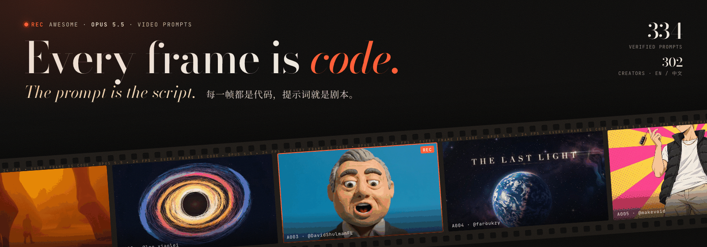

<div align="center">

<a href="https://li-evan.github.io/awesome-opus-5.5-video-prompts/"></a>

# Awesome Opus 5.5 Video Prompts [](https://awesome.re)

Prompts people actually used to make videos with Claude Opus 5.5, copied word for word from each creator's own post.

**English** · [简体中文](README.zh-CN.md)

**[▶ Open the gallery](https://li-evan.github.io/awesome-opus-5.5-video-prompts/)** · [Director's toolkit](guide/director-toolkit.md) · [Contribute](contributing.md)

</div>

**334 prompts from 302 creators**, each with a preview, the original post, a Chinese translation, and notes on tools, inputs and cost. Opus 5.5 does not generate pixels: it writes code that draws every frame, so the prompt is the whole recipe.

## Why this list

- **Verified at the source.** Every prompt is copied from the creator's own post, thread or reply and machine-checked against it. No paraphrases, no prompts from other people's lists.
- **Bilingual.** Every prompt keeps its original language and comes with an English or Chinese translation.
- **Learn to direct, not just copy.** The toolkit explains how the best prompts are built, the words that change a render, and how to fix a one-shot result.

## Contents

- [Quick Start](#quick-start)
- [Most-Saved Prompts](#most-saved-prompts)
- [Browse by Category](#browse-by-category)
  - [🎬 Showreels and Motion Design](#-showreels-and-motion-design)
  - [🚀 Product Launches and Ads](#-product-launches-and-ads)
  - [🧠 Explainers and Education](#-explainers-and-education)
  - [📜 History and Documentary](#-history-and-documentary)
  - [🎵 Music Videos and Lyrics](#-music-videos-and-lyrics)
  - [🎨 Stories, Hand-Drawn and Stop-Motion](#-stories-hand-drawn-and-stop-motion)
  - [🪞 Opus on Itself](#-opus-on-itself)
  - [🧊 3D, Shaders and Worlds](#-3d-shaders-and-worlds)
  - [🔁 Remakes and Transformations](#-remakes-and-transformations)
- [The Six-Step Director Workflow](#the-six-step-director-workflow)
- [Tools, Skills and Guides](#tools-skills-and-guides)
- [How Entries Are Collected](#how-entries-are-collected)
- [Rights and Takedown](#rights-and-takedown)
- [Contributing](#contributing)

## Quick Start

Opus 5.5 does not output video. It writes code that draws every frame (HTML Canvas, SVG, Three.js, Remotion, HyperFrames, Manim), renders the frames in a headless browser and stitches them into an MP4 with ffmpeg. That is why it is great at motion graphics, explainers and launch films, and why a change is a one-line edit and a re-render instead of a new roll of the dice.

1. Open Claude Code (or the Claude app) with Opus 5.5 and set effort to high or max.
2. Give it a renderer so it can produce a real MP4: `npx skills add heygen-com/hyperframes` or `npx skills add remotion-dev/skills`. You need Node 22+, Chrome and ffmpeg.
3. Start in an empty folder, paste a prompt from this list, and swap in your own subject, brand and assets.
4. Ask for one still frame per scene before the full render, then give notes like a director (see the vocabulary below).

**Three prompts to try first**

- **Showreel with Blender 3D and self-made soundtrack** ([@shneural](https://x.com/shneural) · 2026-09-24 · 🔖 6.2k · ▶ 1.7M · `One-shot` · Blender · Python)

  ```text
  make a dynamic 15-second motion graphics video that shows what an incredible motion designer you are, like it's your showreel for a résumé. go all out.
  ```

- **What is a Transformer, a 12-minute explainer** ([@dotey](https://x.com/dotey) · 2026-09-26 · 🔖 1.6k · ▶ 165.6k · `Brief` · Remotion · TTS)

  ```text
  帮我用js制作一个视频，主题是：什么是 Transformer
  要深入浅出，让高中生也能看得懂，不仅high level说的清楚，也要有细节，包括注意力机制，甚至一些数学概念

  你可以用任何工具或者安装工具，可以联网检索

  请给我惊喜
  ```

- **Pixel art wizard casting a spell** ([@majidmanzarpour](https://x.com/majidmanzarpour) · 2026-09-22 · 🔖 2.6k · ▶ 438.7k · `Spec` · Canvas)

  ```text
  Create a single self-contained HTML file that renders an animated pixel art wizard casting a spell, using vanilla JavaScript and Canvas 2D. No external assets, libraries, or network requests.

  RENDERING
  - Draw everything to an offscreen canvas at a fixed logical resolution of 128x96, then blit to a fullscreen display canvas scaled by the largest integer factor that fits the window, centered, with imageSmoothingEnabled = false and CSS image-rendering: pixelated.
  - All drawing snaps to integer coordinates on the logical canvas. No sub-pixel positions, anti-aliasing, gradients, or shadowBlur.
  - Fixed palette of ~24 hex colors: deep blues/purples for night sky, warm robe tones, 3-4 bright magic colors. Every pixel comes from this palette.

  CHARACTER
  - Build the wizard procedurally from filled rects and pixel runs, ~24x32 logical pixels: pointed hat with a bend, long beard, two-shade robe with darker outline, staff with a gem at the tip.
  - Parameterize the pose (staff angle, arm raise, head tilt, robe sway). Animate parameters smoothly, then quantize to the pixel grid each frame so motion reads at an 8-12 fps pixel animation feel even though the loop runs at 60fps.

  ANIMATION
  - Looping state machine: IDLE (2-frame bob, beard sway) -> CHARGE (staff raises, gem flickers, sparks spiral inward) -> CAST (bright burst, projectile fires across the scene, 1-2 pixel screen shake) -> RECOVER (settle back). Ease pose parameters between keyframes.
  - Pooled allocation-free particle system: preallocate and reuse. Sparks orbit the gem during CHARGE, explode outward on CAST, each particle stepping its palette index from white to magic color to dark before despawn. Snap particle positions to the grid when drawing.
  - Fixed 60hz timestep update with rAF rendering. Zero object allocation inside the loop.

  SCENE
  - Minimal background: dark sky, a few twinkling 1px stars, moon, stone floor line. Character silhouette must read clearly.
  - Subtle 1px rim light on the wizard from the gem, brightening during CHARGE and CAST.

  QUALITY BAR
  - Crisp pixels at any window size, seamless loop, stable 60fps, readable silhouette. Should look like a polished 16-bit sprite animation, not vector shapes scaled down.
  ```

## Most-Saved Prompts

Ranked by bookmarks on the original post, the best signal of "I want to reuse this".

<table>
<tr>
<td width="33%" valign="top"><a href="https://github.com/Li-Evan/awesome-opus-5.5-video-prompts/blob/main/prompts/showreel.md#one-shape-ui-morph-loop-synced-to-music"></a><br><b><a href="https://github.com/Li-Evan/awesome-opus-5.5-video-prompts/blob/main/prompts/showreel.md#one-shape-ui-morph-loop-synced-to-music">One-shape UI morph loop synced to music</a></b><br><sub>@twoclipping · 🔖 19.4k · ▶ 933.8k · Template</sub><br>A square UI motion loop where one shape morphs through button, player, slider, tabs, chart and ⌘K on a 120 BPM grid, rendered with Playwright and ffmpeg motion blur.</td><td width="33%" valign="top"><a href="https://github.com/Li-Evan/awesome-opus-5.5-video-prompts/blob/main/prompts/music.md#claude-pop-music-video-remake"></a><br><b><a href="https://github.com/Li-Evan/awesome-opus-5.5-video-prompts/blob/main/prompts/music.md#claude-pop-music-video-remake">Claude Pop music video remake</a></b><br><sub>@donaldjewkes · 🔖 8.9k · ▶ 2.8M · Pipeline</sub><br>A 2.5-minute music video for the song &quot;Claude Pop&quot;, with Seedance 2.5 base footage, ElevenLabs sound design and JavaScript lyric animation, from a spoken brief.</td><td width="33%" valign="top"><a href="https://github.com/Li-Evan/awesome-opus-5.5-video-prompts/blob/main/prompts/showreel.md#showreel-with-blender-3d-and-self-made-soundtrack"></a><br><b><a href="https://github.com/Li-Evan/awesome-opus-5.5-video-prompts/blob/main/prompts/showreel.md#showreel-with-blender-3d-and-self-made-soundtrack">Showreel with Blender 3D and self-made soundtrack</a></b><br><sub>@shneural · 🔖 6.2k · ▶ 1.7M · One-shot</sub><br>The one-sentence showreel prompt in stock Claude Code on max: Opus chose to add a Blender 3D section and sequenced its own 128 BPM soundtrack.</td>
</tr>
<tr>
<td width="33%" valign="top"><a href="https://github.com/Li-Evan/awesome-opus-5.5-video-prompts/blob/main/prompts/launch.md#launch-video-for-an-ai-inference-startup"></a><br><b><a href="https://github.com/Li-Evan/awesome-opus-5.5-video-prompts/blob/main/prompts/launch.md#launch-video-for-an-ai-inference-startup">Launch video for an AI inference startup</a></b><br><sub>@deedydas · 🔖 4.7k · ▶ 338.8k · One-shot</sub><br>A 26-second launch video for an AI inference startup, coded as a web animation and recorded with Playwright and ffmpeg; no video model used.</td><td width="33%" valign="top"><a href="https://github.com/Li-Evan/awesome-opus-5.5-video-prompts/blob/main/prompts/launch.md#apple-keynote-style-launch-film-template"></a><br><b><a href="https://github.com/Li-Evan/awesome-opus-5.5-video-prompts/blob/main/prompts/launch.md#apple-keynote-style-launch-film-template">Apple-keynote style launch film template</a></b><br><sub>@twoclipping · 🔖 3.3k · ▶ 99.4k · Template</sub><br>A 29-second one-take launch film where every scene morphs from the last: liquid glass, iris wipes, real wall footage, all timed to 120 BPM.</td><td width="33%" valign="top"><a href="https://github.com/Li-Evan/awesome-opus-5.5-video-prompts/blob/main/prompts/story.md#pixel-art-wizard-casting-a-spell"></a><br><b><a href="https://github.com/Li-Evan/awesome-opus-5.5-video-prompts/blob/main/prompts/story.md#pixel-art-wizard-casting-a-spell">Pixel art wizard casting a spell</a></b><br><sub>@majidmanzarpour · 🔖 2.6k · ▶ 438.7k · Spec</sub><br>A seamless looping 16-bit pixel art animation of a wizard charging and casting a spell, drawn procedurally at 128x96 with Canvas 2D in one HTML file.</td>
</tr>
<tr>
<td width="33%" valign="top"><a href="https://github.com/Li-Evan/awesome-opus-5.5-video-prompts/blob/main/prompts/launch.md#cosmos-launch-video-in-hyperframes"></a><br><b><a href="https://github.com/Li-Evan/awesome-opus-5.5-video-prompts/blob/main/prompts/launch.md#cosmos-launch-video-in-hyperframes">Cosmos launch video in HyperFrames</a></b><br><sub>@kaolti · 🔖 1.8k · ▶ 64.7k · Pipeline</sub><br>A 40-second Cosmos launch video in HyperFrames Studio: one prompt researches and builds it, a second has Opus review it and make it 5x more exciting.</td><td width="33%" valign="top"><a href="https://github.com/Li-Evan/awesome-opus-5.5-video-prompts/blob/main/prompts/explainer.md#what-is-a-transformer-a-12-minute-explainer"></a><br><b><a href="https://github.com/Li-Evan/awesome-opus-5.5-video-prompts/blob/main/prompts/explainer.md#what-is-a-transformer-a-12-minute-explainer">What is a Transformer, a 12-minute explainer</a></b><br><sub>@dotey · 🔖 1.6k · ▶ 165.6k · Brief</sub><br>A 12-minute explainer on Transformers and attention for high school students, one-shot on xhigh; Opus found free Edge TTS for narration and used Remotion with KaTeX.</td><td width="33%" valign="top"><a href="https://github.com/Li-Evan/awesome-opus-5.5-video-prompts/blob/main/prompts/explainer.md#cocktail-recipe-motion-graphic-from-one-photo"></a><br><b><a href="https://github.com/Li-Evan/awesome-opus-5.5-video-prompts/blob/main/prompts/explainer.md#cocktail-recipe-motion-graphic-from-one-photo">Cocktail recipe motion graphic from one photo</a></b><br><sub>@Ror_Fly · 🔖 1.4k · ▶ 73.6k · Brief</sub><br>A 30-second explainer-style recipe animation built in HTML from a single image, pouring each ingredient and measurement from empty glass to finished cocktail.</td>
</tr>
<tr>
<td width="33%" valign="top"><a href="https://github.com/Li-Evan/awesome-opus-5.5-video-prompts/blob/main/prompts/launch.md#minimal-product-launch-video-template"></a><br><b><a href="https://github.com/Li-Evan/awesome-opus-5.5-video-prompts/blob/main/prompts/launch.md#minimal-product-launch-video-template">Minimal product launch video template</a></b><br><sub>@twoclipping · 🔖 1.4k · ▶ 50.1k · Template</sub><br>A 20-second 1080p product launch template cut to a 120 BPM beat grid, using your own vertical clips, masked type, a 3D video carousel and peak-aligned sound effects.</td><td width="33%" valign="top"><a href="https://github.com/Li-Evan/awesome-opus-5.5-video-prompts/blob/main/prompts/worlds.md#pixel-art-paris-night-diorama-lofi-loop"></a><br><b><a href="https://github.com/Li-Evan/awesome-opus-5.5-video-prompts/blob/main/prompts/worlds.md#pixel-art-paris-night-diorama-lofi-loop">Pixel-art Paris night diorama lofi loop</a></b><br><sub>@minosdevs · 🔖 1.4k · ▶ 135.3k · Spec</sub><br>A seamless 4-minute pixel-art loop of rainy Paris at night with the Eiffel Tower, the Seine and falling euro notes, built as a lofi background.</td><td width="33%" valign="top"><a href="https://github.com/Li-Evan/awesome-opus-5.5-video-prompts/blob/main/prompts/showreel.md#motion-designer-résumé-reel-on-max-effort"></a><br><b><a href="https://github.com/Li-Evan/awesome-opus-5.5-video-prompts/blob/main/prompts/showreel.md#motion-designer-résumé-reel-on-max-effort">Motion designer résumé reel on max effort</a></b><br><sub>@darel023 · 🔖 1.1k · ▶ 66k · Brief</sub><br>A 15-second motion design résumé reel on max effort: a hook in the first second, then typography, shape play, camera moves and colour shifts, paced as if cut to music.</td>
</tr>
</table>

## Browse by Category

| | Category | Prompts |
|---|---|---:|
| 🎬 | [Showreels and Motion Design](prompts/showreel.md) | 48 |
| 🚀 | [Product Launches and Ads](prompts/launch.md) | 136 |
| 🧠 | [Explainers and Education](prompts/explainer.md) | 31 |
| 📜 | [History and Documentary](prompts/history.md) | 20 |
| 🎵 | [Music Videos and Lyrics](prompts/music.md) | 18 |
| 🎨 | [Stories, Hand-Drawn and Stop-Motion](prompts/story.md) | 36 |
| 🪞 | [Opus on Itself](prompts/self.md) | 16 |
| 🧊 | [3D, Shaders and Worlds](prompts/worlds.md) | 15 |
| 🔁 | [Remakes and Transformations](prompts/remix.md) | 14 |

### 🎬 Showreels and Motion Design

Showreels, abstract motion graphics, UI motion and kinetic type. The genre that started the trend.

<table>
<tr>
<td width="33%" valign="top"><a href="https://github.com/Li-Evan/awesome-opus-5.5-video-prompts/blob/main/prompts/showreel.md#one-shape-ui-morph-loop-synced-to-music"></a><br><b><a href="https://github.com/Li-Evan/awesome-opus-5.5-video-prompts/blob/main/prompts/showreel.md#one-shape-ui-morph-loop-synced-to-music">One-shape UI morph loop synced to music</a></b><br><sub>@twoclipping · 🔖 19.4k · ▶ 933.8k · Template</sub><br>A square UI motion loop where one shape morphs through button, player, slider, tabs, chart and ⌘K on a 120 BPM grid, rendered with Playwright and ffmpeg motion blur.</td><td width="33%" valign="top"><a href="https://github.com/Li-Evan/awesome-opus-5.5-video-prompts/blob/main/prompts/showreel.md#showreel-with-blender-3d-and-self-made-soundtrack"></a><br><b><a href="https://github.com/Li-Evan/awesome-opus-5.5-video-prompts/blob/main/prompts/showreel.md#showreel-with-blender-3d-and-self-made-soundtrack">Showreel with Blender 3D and self-made soundtrack</a></b><br><sub>@shneural · 🔖 6.2k · ▶ 1.7M · One-shot</sub><br>The one-sentence showreel prompt in stock Claude Code on max: Opus chose to add a Blender 3D section and sequenced its own 128 BPM soundtrack.</td><td width="33%" valign="top"><a href="https://github.com/Li-Evan/awesome-opus-5.5-video-prompts/blob/main/prompts/showreel.md#motion-designer-résumé-reel-on-max-effort"></a><br><b><a href="https://github.com/Li-Evan/awesome-opus-5.5-video-prompts/blob/main/prompts/showreel.md#motion-designer-résumé-reel-on-max-effort">Motion designer résumé reel on max effort</a></b><br><sub>@darel023 · 🔖 1.1k · ▶ 66k · Brief</sub><br>A 15-second motion design résumé reel on max effort: a hook in the first second, then typography, shape play, camera moves and colour shifts, paced as if cut to music.</td>
</tr>
<tr>
<td width="33%" valign="top"><a href="https://github.com/Li-Evan/awesome-opus-5.5-video-prompts/blob/main/prompts/showreel.md#mobile-game-reward-animation-template"></a><br><b><a href="https://github.com/Li-Evan/awesome-opus-5.5-video-prompts/blob/main/prompts/showreel.md#mobile-game-reward-animation-template">Mobile game reward animation template</a></b><br><sub>@op7418 · 🔖 899 · ▶ 65.1k · Template</sub><br>A template for mobile-game reward animations like opening a chest or ranking up: a toon-shaded Three.js object, five staged beats, GSAP timelines and Web Audio sound.</td><td width="33%" valign="top"><a href="https://github.com/Li-Evan/awesome-opus-5.5-video-prompts/blob/main/prompts/showreel.md#kinetic-type-bumper-for-a-creator-brand"></a><br><b><a href="https://github.com/Li-Evan/awesome-opus-5.5-video-prompts/blob/main/prompts/showreel.md#kinetic-type-bumper-for-a-creator-brand">Kinetic type bumper for a creator brand</a></b><br><sub>@techhalla · 🔖 329 · ▶ 30.4k · Spec</sub><br>A 20-second looping 1080×1080 kinetic-typography bumper for TechHalla in black, magenta and acid green, with per-glyph springs, mask wipes and print misregistration, built in one HTML file.</td><td width="33%" valign="top"><a href="https://github.com/Li-Evan/awesome-opus-5.5-video-prompts/blob/main/prompts/showreel.md#showreel-with-a-code-synthesized-beat-synced-soundtrack"></a><br><b><a href="https://github.com/Li-Evan/awesome-opus-5.5-video-prompts/blob/main/prompts/showreel.md#showreel-with-a-code-synthesized-beat-synced-soundtrack">Showreel with a code-synthesized, beat-synced soundtrack</a></b><br><sub>@prasenx · 🔖 100 · ▶ 13k · Brief</sub><br>The showreel prompt extended with a fully code-synthesized soundtrack, cuts locked to the beat and a 1080p 60fps MP4 output; made in Cursor.</td>
</tr>
</table>

**[See all 48 prompts →](prompts/showreel.md)**

### 🚀 Product Launches and Ads

Launch films, app and SaaS promos, brand spots and commercials.

<table>
<tr>
<td width="33%" valign="top"><a href="https://github.com/Li-Evan/awesome-opus-5.5-video-prompts/blob/main/prompts/launch.md#launch-video-for-an-ai-inference-startup"></a><br><b><a href="https://github.com/Li-Evan/awesome-opus-5.5-video-prompts/blob/main/prompts/launch.md#launch-video-for-an-ai-inference-startup">Launch video for an AI inference startup</a></b><br><sub>@deedydas · 🔖 4.7k · ▶ 338.8k · One-shot</sub><br>A 26-second launch video for an AI inference startup, coded as a web animation and recorded with Playwright and ffmpeg; no video model used.</td><td width="33%" valign="top"><a href="https://github.com/Li-Evan/awesome-opus-5.5-video-prompts/blob/main/prompts/launch.md#apple-keynote-style-launch-film-template"></a><br><b><a href="https://github.com/Li-Evan/awesome-opus-5.5-video-prompts/blob/main/prompts/launch.md#apple-keynote-style-launch-film-template">Apple-keynote style launch film template</a></b><br><sub>@twoclipping · 🔖 3.3k · ▶ 99.4k · Template</sub><br>A 29-second one-take launch film where every scene morphs from the last: liquid glass, iris wipes, real wall footage, all timed to 120 BPM.</td><td width="33%" valign="top"><a href="https://github.com/Li-Evan/awesome-opus-5.5-video-prompts/blob/main/prompts/launch.md#cosmos-launch-video-in-hyperframes"></a><br><b><a href="https://github.com/Li-Evan/awesome-opus-5.5-video-prompts/blob/main/prompts/launch.md#cosmos-launch-video-in-hyperframes">Cosmos launch video in HyperFrames</a></b><br><sub>@kaolti · 🔖 1.8k · ▶ 64.7k · Pipeline</sub><br>A 40-second Cosmos launch video in HyperFrames Studio: one prompt researches and builds it, a second has Opus review it and make it 5x more exciting.</td>
</tr>
<tr>
<td width="33%" valign="top"><a href="https://github.com/Li-Evan/awesome-opus-5.5-video-prompts/blob/main/prompts/launch.md#minimal-product-launch-video-template"></a><br><b><a href="https://github.com/Li-Evan/awesome-opus-5.5-video-prompts/blob/main/prompts/launch.md#minimal-product-launch-video-template">Minimal product launch video template</a></b><br><sub>@twoclipping · 🔖 1.4k · ▶ 50.1k · Template</sub><br>A 20-second 1080p product launch template cut to a 120 BPM beat grid, using your own vertical clips, masked type, a 3D video carousel and peak-aligned sound effects.</td><td width="33%" valign="top"><a href="https://github.com/Li-Evan/awesome-opus-5.5-video-prompts/blob/main/prompts/launch.md#product-focused-motion-graphics-video-template"></a><br><b><a href="https://github.com/Li-Evan/awesome-opus-5.5-video-prompts/blob/main/prompts/launch.md#product-focused-motion-graphics-video-template">Product-focused motion graphics video template</a></b><br><sub>@ann_nnng · 🔖 1.1k · ▶ 95.2k · Template</sub><br>A 15-second motion graphics video about your product: Opus first visits the product pages, then writes the video content itself. Made in Claude Code.</td><td width="33%" valign="top"><a href="https://github.com/Li-Evan/awesome-opus-5.5-video-prompts/blob/main/prompts/launch.md#saas-launch-video-for-a-product-opus-picks"></a><br><b><a href="https://github.com/Li-Evan/awesome-opus-5.5-video-prompts/blob/main/prompts/launch.md#saas-launch-video-for-a-product-opus-picks">SaaS launch video for a product Opus picks</a></b><br><sub>@moritzkremb · 🔖 946 · ▶ 88.8k · Brief</sub><br>A 46-second SaaS launch video where Opus picks a well-known product, pulls real assets from the web and edits a features-and-benefits promo, built with HyperFrames.</td>
</tr>
</table>

**[See all 136 prompts →](prompts/launch.md)**

### 🧠 Explainers and Education

Science, math, tech and how-it-works videos, often with Manim or narration.

<table>
<tr>
<td width="33%" valign="top"><a href="https://github.com/Li-Evan/awesome-opus-5.5-video-prompts/blob/main/prompts/explainer.md#what-is-a-transformer-a-12-minute-explainer"></a><br><b><a href="https://github.com/Li-Evan/awesome-opus-5.5-video-prompts/blob/main/prompts/explainer.md#what-is-a-transformer-a-12-minute-explainer">What is a Transformer, a 12-minute explainer</a></b><br><sub>@dotey · 🔖 1.6k · ▶ 165.6k · Brief</sub><br>A 12-minute explainer on Transformers and attention for high school students, one-shot on xhigh; Opus found free Edge TTS for narration and used Remotion with KaTeX.</td><td width="33%" valign="top"><a href="https://github.com/Li-Evan/awesome-opus-5.5-video-prompts/blob/main/prompts/explainer.md#cocktail-recipe-motion-graphic-from-one-photo"></a><br><b><a href="https://github.com/Li-Evan/awesome-opus-5.5-video-prompts/blob/main/prompts/explainer.md#cocktail-recipe-motion-graphic-from-one-photo">Cocktail recipe motion graphic from one photo</a></b><br><sub>@Ror_Fly · 🔖 1.4k · ▶ 73.6k · Brief</sub><br>A 30-second explainer-style recipe animation built in HTML from a single image, pouring each ingredient and measurement from empty glass to finished cocktail.</td><td width="33%" valign="top"><a href="https://github.com/Li-Evan/awesome-opus-5.5-video-prompts/blob/main/prompts/explainer.md#atmospheric-circulation-lesson-in-line-art"></a><br><b><a href="https://github.com/Li-Evan/awesome-opus-5.5-video-prompts/blob/main/prompts/explainer.md#atmospheric-circulation-lesson-in-line-art">Atmospheric circulation lesson in line art</a></b><br><sub>@akokoi1 · 🔖 808 · ▶ 134.5k · Brief</sub><br>A nearly 5-minute line-art lesson on atmospheric circulation for high school geography, with bilingual subtitles, music and TTS narration wired in through a TTS.md doc and .env keys.</td>
</tr>
<tr>
<td width="33%" valign="top"><a href="https://github.com/Li-Evan/awesome-opus-5.5-video-prompts/blob/main/prompts/explainer.md#how-encryption-secures-file-transfers"></a><br><b><a href="https://github.com/Li-Evan/awesome-opus-5.5-video-prompts/blob/main/prompts/explainer.md#how-encryption-secures-file-transfers">How encryption secures file transfers</a></b><br><sub>@SyntaxDiffusion · 🔖 567 · ▶ 35.5k · One-shot</sub><br>A 96-second visual explainer of encryption in secure file transfers, built in the Sentinel agent environment, with all audio synthesized in Python and mixed with ffmpeg.</td><td width="33%" valign="top"><a href="https://github.com/Li-Evan/awesome-opus-5.5-video-prompts/blob/main/prompts/explainer.md#manim-lesson-on-derivatives"></a><br><b><a href="https://github.com/Li-Evan/awesome-opus-5.5-video-prompts/blob/main/prompts/explainer.md#manim-lesson-on-derivatives">Manim lesson on derivatives</a></b><br><sub>@LinearUncle · 🔖 360 · ▶ 22k · One-shot</sub><br>A 7.5-minute Manim lesson on the concept of the derivative, with worked examples and edge-tts voice-over.</td><td width="33%" valign="top"><a href="https://github.com/Li-Evan/awesome-opus-5.5-video-prompts/blob/main/prompts/explainer.md#recursion-explained-in-nine-video-styles"></a><br><b><a href="https://github.com/Li-Evan/awesome-opus-5.5-video-prompts/blob/main/prompts/explainer.md#recursion-explained-in-nine-video-styles">Recursion explained in nine video styles</a></b><br><sub>@emollick · 🔖 275 · ▶ 61.1k · One-shot</sub><br>A 75-second self-referential explainer of recursion that switches video style nine times; scenes drawn in React and SVG, music and effects synthesized in Python.</td>
</tr>
</table>

**[See all 31 prompts →](prompts/explainer.md)**

### 📜 History and Documentary

Timelines, civilizations, battles and biographies told in motion.

<table>
<tr>
<td width="33%" valign="top"><a href="https://github.com/Li-Evan/awesome-opus-5.5-video-prompts/blob/main/prompts/history.md#battle-of-austerlitz-as-a-5-minute-film"></a><br><b><a href="https://github.com/Li-Evan/awesome-opus-5.5-video-prompts/blob/main/prompts/history.md#battle-of-austerlitz-as-a-5-minute-film">Battle of Austerlitz as a 5-minute film</a></b><br><sub>@WinterArc2125 · 🔖 1k · ▶ 394.5k · Brief</sub><br>A 5-minute cinematic film of the Battle of Austerlitz rendered in code, with real satellite terrain, a historically placed sunrise, and its own score and narration.</td><td width="33%" valign="top"><a href="https://github.com/Li-Evan/awesome-opus-5.5-video-prompts/blob/main/prompts/history.md#1906-san-francisco-market-street-in-blender"></a><br><b><a href="https://github.com/Li-Evan/awesome-opus-5.5-video-prompts/blob/main/prompts/history.md#1906-san-francisco-market-street-in-blender">1906 San Francisco Market Street in Blender</a></b><br><sub>@alexalbert__ · 🔖 418 · ▶ 147.2k · Spec</sub><br>A 10-second camera move up San Francisco&#x27;s Market Street on the eve of the 1906 earthquake, modeled in Blender Python from fire-insurance maps, period film and photos.</td><td width="33%" valign="top"><a href="https://github.com/Li-Evan/awesome-opus-5.5-video-prompts/blob/main/prompts/history.md#sand-animation-of-250-years-of-us-history"></a><br><b><a href="https://github.com/Li-Evan/awesome-opus-5.5-video-prompts/blob/main/prompts/history.md#sand-animation-of-250-years-of-us-history">Sand animation of 250 years of US history</a></b><br><sub>@Michaelzsguo · 🔖 353 · ▶ 71.4k · One-shot</sub><br>A 2-minute sand-art animation of 250 years of U.S. history, with music and sound design, generated in code by Claude Code without Blender or Three.js.</td>
</tr>
<tr>
<td width="33%" valign="top"><a href="https://github.com/Li-Evan/awesome-opus-5.5-video-prompts/blob/main/prompts/history.md#doodle-history-of-humanity-ending-with-opus-55"></a><br><b><a href="https://github.com/Li-Evan/awesome-opus-5.5-video-prompts/blob/main/prompts/history.md#doodle-history-of-humanity-ending-with-opus-55">Doodle history of humanity ending with Opus 5.5</a></b><br><sub>@songkeys · 🔖 212 · ▶ 35.2k · Brief</sub><br>A 108-second origami and doodle animation of civilization from its start to the hatching of AI and Opus 5.5, with almost no text, built in pure JavaScript.</td><td width="33%" valign="top"><a href="https://github.com/Li-Evan/awesome-opus-5.5-video-prompts/blob/main/prompts/history.md#epic-chronicle-of-chinese-civilization"></a><br><b><a href="https://github.com/Li-Evan/awesome-opus-5.5-video-prompts/blob/main/prompts/history.md#epic-chronicle-of-chinese-civilization">Epic chronicle of Chinese civilization</a></b><br><sub>@dotey · 🔖 212 · ▶ 25.5k · Brief</sub><br>A 3.5-minute chronicle of Chinese history alternating ink line art and gold-on-black styles, cut to a pentatonic score whose BPM rises with each era.</td><td width="33%" valign="top"><a href="https://github.com/Li-Evan/awesome-opus-5.5-video-prompts/blob/main/prompts/history.md#81-years-of-indonesian-history-in-a-minute"></a><br><b><a href="https://github.com/Li-Evan/awesome-opus-5.5-video-prompts/blob/main/prompts/history.md#81-years-of-indonesian-history-in-a-minute">81 years of Indonesian history in a minute</a></b><br><sub>@hanifproduktif · 🔖 120 · ▶ 9.9k · One-shot</sub><br>A 59-second, light-hearted line-drawing recap of 81 years of Indonesian history, with music and an ElevenLabs voiceover.</td>
</tr>
</table>

**[See all 20 prompts →](prompts/history.md)**

### 🎵 Music Videos and Lyrics

Music videos, lyric videos and audio-reactive pieces, many with generated soundtracks.

<table>
<tr>
<td width="33%" valign="top"><a href="https://github.com/Li-Evan/awesome-opus-5.5-video-prompts/blob/main/prompts/music.md#claude-pop-music-video-remake"></a><br><b><a href="https://github.com/Li-Evan/awesome-opus-5.5-video-prompts/blob/main/prompts/music.md#claude-pop-music-video-remake">Claude Pop music video remake</a></b><br><sub>@donaldjewkes · 🔖 8.9k · ▶ 2.8M · Pipeline</sub><br>A 2.5-minute music video for the song &quot;Claude Pop&quot;, with Seedance 2.5 base footage, ElevenLabs sound design and JavaScript lyric animation, from a spoken brief.</td><td width="33%" valign="top"><a href="https://github.com/Li-Evan/awesome-opus-5.5-video-prompts/blob/main/prompts/music.md#1990s-demoscene-demo-synced-to-a-tracker-song"></a><br><b><a href="https://github.com/Li-Evan/awesome-opus-5.5-video-prompts/blob/main/prompts/music.md#1990s-demoscene-demo-synced-to-a-tracker-song">1990s demoscene demo synced to a tracker song</a></b><br><sub>@gandamu_ml · 🔖 358 · ▶ 37.5k · Brief</sub><br>A 6-minute real-time 1990s-style demoscene demo in C/C++ and OpenGL, with effects synced to Purple Motion&#x27;s Second Reality S3M track that the author supplied.</td><td width="33%" valign="top"><a href="https://github.com/Li-Evan/awesome-opus-5.5-video-prompts/blob/main/prompts/music.md#15-second-kinetic-typography-music-video"></a><br><b><a href="https://github.com/Li-Evan/awesome-opus-5.5-video-prompts/blob/main/prompts/music.md#15-second-kinetic-typography-music-video">15-second kinetic typography music video</a></b><br><sub>@itnavi2022 · 🔖 231 · ▶ 15.5k · One-shot</sub><br>A 15-second kinetic typography music video in which the lettering dances to the music, made with Opus 5.5 alone.</td>
</tr>
<tr>
<td width="33%" valign="top"><b><a href="https://github.com/Li-Evan/awesome-opus-5.5-video-prompts/blob/main/prompts/music.md#rick-astleys-dance-in-painted-brushstrokes">Rick Astley&#x27;s dance in painted brushstrokes</a></b><br><sub>@petergostev · 🔖 158 · ▶ 11.3k · Brief</sub><br>A one-minute HTML animation of Rick Astley&#x27;s dance in bold moving brushstrokes, synced to music also written in code; the source is on GitHub.</td><td width="33%" valign="top"><a href="https://github.com/Li-Evan/awesome-opus-5.5-video-prompts/blob/main/prompts/music.md#ai-lore-music-video-for-a-suno-song"></a><br><b><a href="https://github.com/Li-Evan/awesome-opus-5.5-video-prompts/blob/main/prompts/music.md#ai-lore-music-video-for-a-suno-song">AI-lore music video for a Suno song</a></b><br><sub>@doubleunplussed · 🔖 93 · ▶ 24.6k · Brief</sub><br>A 4-minute music video for a Suno song about AI, full of AI-safety lore references, styled after an existing code-animated video and refined with two follow-up notes.</td><td width="33%" valign="top"><a href="https://github.com/Li-Evan/awesome-opus-5.5-video-prompts/blob/main/prompts/music.md#creepy-pizza-parlor-music-video"></a><br><b><a href="https://github.com/Li-Evan/awesome-opus-5.5-video-prompts/blob/main/prompts/music.md#creepy-pizza-parlor-music-video">Creepy pizza parlor music video</a></b><br><sub>@ParanoidAmerica · 🔖 18 · ▶ 7.6k · Brief</sub><br>A 2-minute-21-second lyric-synced music video mixing Monty Python-style cutouts with ballpoint sketches; Opus made the art through a local ComfyUI with SDXL.</td>
</tr>
</table>

**[See all 18 prompts →](prompts/music.md)**

### 🎨 Stories, Hand-Drawn and Stop-Motion

Narrative shorts, line art, stop-motion and poems.

<table>
<tr>
<td width="33%" valign="top"><a href="https://github.com/Li-Evan/awesome-opus-5.5-video-prompts/blob/main/prompts/story.md#pixel-art-wizard-casting-a-spell"></a><br><b><a href="https://github.com/Li-Evan/awesome-opus-5.5-video-prompts/blob/main/prompts/story.md#pixel-art-wizard-casting-a-spell">Pixel art wizard casting a spell</a></b><br><sub>@majidmanzarpour · 🔖 2.6k · ▶ 438.7k · Spec</sub><br>A seamless looping 16-bit pixel art animation of a wizard charging and casting a spell, drawn procedurally at 128x96 with Canvas 2D in one HTML file.</td><td width="33%" valign="top"><a href="https://github.com/Li-Evan/awesome-opus-5.5-video-prompts/blob/main/prompts/story.md#glass-and-gold-mosaic-that-comes-alive"></a><br><b><a href="https://github.com/Li-Evan/awesome-opus-5.5-video-prompts/blob/main/prompts/story.md#glass-and-gold-mosaic-that-comes-alive">Glass and gold mosaic that comes alive</a></b><br><sub>@LCSlates · 🔖 867 · ▶ 128.7k · Brief</sub><br>An 80-second square WebGL2 film of a glass and gold-leaf mosaic whose tiles lift, flock into a fish, cranes and stars, then click back, with browser-synthesized sound.</td><td width="33%" valign="top"><a href="https://github.com/Li-Evan/awesome-opus-5.5-video-prompts/blob/main/prompts/story.md#pixel-character-dodging-meteors-in-space"></a><br><b><a href="https://github.com/Li-Evan/awesome-opus-5.5-video-prompts/blob/main/prompts/story.md#pixel-character-dodging-meteors-in-space">Pixel character dodging meteors in space</a></b><br><sub>@riku720720 · 🔖 844 · ▶ 240.9k · Spec</sub><br>A seamless looping 16-bit style demo of an orange pixel character sprinting along a rainbow floor in space, auto-dodging meteors and beams, drawn in Canvas 2D at 160x90.</td>
</tr>
<tr>
<td width="33%" valign="top"><a href="https://github.com/Li-Evan/awesome-opus-5.5-video-prompts/blob/main/prompts/story.md#2d-animated-short-with-story-and-dialogue"></a><br><b><a href="https://github.com/Li-Evan/awesome-opus-5.5-video-prompts/blob/main/prompts/story.md#2d-animated-short-with-story-and-dialogue">2D animated short with story and dialogue</a></b><br><sub>@ALSK_ai · 🔖 778 · ▶ 99.7k · One-shot</sub><br>A 60-second 2D short with story, dialogue, coded music and sound, drawn from one character sheet; the author set it to 1 minute and 10 agents.</td><td width="33%" valign="top"><a href="https://github.com/Li-Evan/awesome-opus-5.5-video-prompts/blob/main/prompts/story.md#35-second-chinese-short-drama-with-a-twist"></a><br><b><a href="https://github.com/Li-Evan/awesome-opus-5.5-video-prompts/blob/main/prompts/story.md#35-second-chinese-short-drama-with-a-twist">35-second Chinese short drama with a twist</a></b><br><sub>@AI_DVD6 · 🔖 466 · ▶ 70.3k · Pipeline</sub><br>A 35-second Chinese micro-drama: Opus proposes and picks the story, then coaches a beginner step by step through generating and editing the shots in Jianying (CapCut).</td><td width="33%" valign="top"><a href="https://github.com/Li-Evan/awesome-opus-5.5-video-prompts/blob/main/prompts/story.md#bbc-style-animated-nature-documentary-on-ai-coders"></a><br><b><a href="https://github.com/Li-Evan/awesome-opus-5.5-video-prompts/blob/main/prompts/story.md#bbc-style-animated-nature-documentary-on-ai-coders">BBC-style animated nature documentary on AI coders</a></b><br><sub>@Tz_2022 · 🔖 221 · ▶ 47.3k · One-shot</sub><br>An almost 8-minute 2D animated mock nature documentary with BBC-style English narration and bilingual subtitles, made from the author&#x27;s satirical script about developers hopping between AI tools.</td>
</tr>
</table>

**[See all 36 prompts →](prompts/story.md)**

### 🪞 Opus on Itself

Prompts that ask Claude what it is, how it sees the world, or what it feels like to be it.

<table>
<tr>
<td width="33%" valign="top"><a href="https://github.com/Li-Evan/awesome-opus-5.5-video-prompts/blob/main/prompts/self.md#opening-credits-for-a-film-about-claude"></a><br><b><a href="https://github.com/Li-Evan/awesome-opus-5.5-video-prompts/blob/main/prompts/self.md#opening-credits-for-a-film-about-claude">Opening credits for a film about Claude</a></b><br><sub>@goodside · 🔖 196 · ▶ 57.7k · One-shot</sub><br>A 75-second opening-credits sequence for an imagined film about Claude, with invented names; the model chose auteur homages as its style and returned an MP4.</td><td width="33%" valign="top"><a href="https://github.com/Li-Evan/awesome-opus-5.5-video-prompts/blob/main/prompts/self.md#claude-characters-shooting-a-film-about-claude-code"></a><br><b><a href="https://github.com/Li-Evan/awesome-opus-5.5-video-prompts/blob/main/prompts/self.md#claude-characters-shooting-a-film-about-claude-code">Claude characters shooting a film about Claude Code</a></b><br><sub>@daniel_mac8 · 🔖 183 · ▶ 14.2k · Brief</sub><br>A 30-second animation for an X post where a Claude Code terminal bursts into Claude-icon characters shooting an action film, styled after reference videos.</td><td width="33%" valign="top"><a href="https://github.com/Li-Evan/awesome-opus-5.5-video-prompts/blob/main/prompts/self.md#claudes-own-sketchbook-flipped-page-by-page"></a><br><b><a href="https://github.com/Li-Evan/awesome-opus-5.5-video-prompts/blob/main/prompts/self.md#claudes-own-sketchbook-flipped-page-by-page">Claude&#x27;s own sketchbook, flipped page by page</a></b><br><sub>@kloss_xyz · 🔖 86 · ▶ 7.1k · Spec</sub><br>A 2.5-minute flip-through of a 20-page sketchbook Claude fills with its own thoughts in invented handwriting, with Three.js page curls and a code-synthesized felt-piano score.</td>
</tr>
<tr>
<td width="33%" valign="top"><a href="https://github.com/Li-Evan/awesome-opus-5.5-video-prompts/blob/main/prompts/self.md#opus-55-edits-a-mid-autumn-capcut-video"></a><br><b><a href="https://github.com/Li-Evan/awesome-opus-5.5-video-prompts/blob/main/prompts/self.md#opus-55-edits-a-mid-autumn-capcut-video">Opus 5.5 edits a Mid-Autumn CapCut video</a></b><br><sub>@Gorden_Sun · 🔖 74 · ▶ 8k · Brief</sub><br>A single-take animation of Opus 5.5 editing a Mid-Autumn Festival short in a CapCut-style workflow, with self-composed electronic music cut to the beat.</td><td width="33%" valign="top"><a href="https://github.com/Li-Evan/awesome-opus-5.5-video-prompts/blob/main/prompts/self.md#opus-55-promo-animation-drawn-in-javascript"></a><br><b><a href="https://github.com/Li-Evan/awesome-opus-5.5-video-prompts/blob/main/prompts/self.md#opus-55-promo-animation-drawn-in-javascript">Opus 5.5 promo animation drawn in JavaScript</a></b><br><sub>@0xLogicrw · 🔖 68 · ▶ 20.9k · One-shot</sub><br>A promo animation for Opus 5.5 itself, drawn entirely in JavaScript with background music; the post sets it beside GPT 6 Sol&#x27;s attempt.</td><td width="33%" valign="top"><a href="https://github.com/Li-Evan/awesome-opus-5.5-video-prompts/blob/main/prompts/self.md#claude-mascots-capability-tour-of-colombia"></a><br><b><a href="https://github.com/Li-Evan/awesome-opus-5.5-video-prompts/blob/main/prompts/self.md#claude-mascots-capability-tour-of-colombia">Claude mascot&#x27;s capability tour of Colombia</a></b><br><sub>@alarcon7a · 🔖 55 · ▶ 14.3k · Brief</sub><br>A 30-second code-only animation where the Claude mascot travels through Colombian landmarks while showing off search, data and coding skills.</td>
</tr>
</table>

**[See all 16 prompts →](prompts/self.md)**

### 🧊 3D, Shaders and Worlds

3D scenes, flythroughs, simulations, shaders and cosmic zooms.

<table>
<tr>
<td width="33%" valign="top"><a href="https://github.com/Li-Evan/awesome-opus-5.5-video-prompts/blob/main/prompts/worlds.md#pixel-art-paris-night-diorama-lofi-loop"></a><br><b><a href="https://github.com/Li-Evan/awesome-opus-5.5-video-prompts/blob/main/prompts/worlds.md#pixel-art-paris-night-diorama-lofi-loop">Pixel-art Paris night diorama lofi loop</a></b><br><sub>@minosdevs · 🔖 1.4k · ▶ 135.3k · Spec</sub><br>A seamless 4-minute pixel-art loop of rainy Paris at night with the Eiffel Tower, the Seine and falling euro notes, built as a lofi background.</td><td width="33%" valign="top"><a href="https://github.com/Li-Evan/awesome-opus-5.5-video-prompts/blob/main/prompts/worlds.md#infinite-zoom-through-vintage-objects"></a><br><b><a href="https://github.com/Li-Evan/awesome-opus-5.5-video-prompts/blob/main/prompts/worlds.md#infinite-zoom-through-vintage-objects">Infinite zoom through vintage objects</a></b><br><sub>@koldo2k · 🔖 933 · ▶ 67.5k · Pipeline</sub><br>A 20-second seamless infinite-zoom loop that flies through vintage objects into new landscapes in a newspaper-collage look; images, Kling animation and music come via the Magnific MCP.</td><td width="33%" valign="top"><a href="https://github.com/Li-Evan/awesome-opus-5.5-video-prompts/blob/main/prompts/worlds.md#word-seeded-cosmic-genesis-animation"></a><br><b><a href="https://github.com/Li-Evan/awesome-opus-5.5-video-prompts/blob/main/prompts/worlds.md#word-seeded-cosmic-genesis-animation">Word-seeded cosmic genesis animation</a></b><br><sub>@MiaAI_lab · 🔖 747 · ▶ 75.3k · One-shot</sub><br>A real-time audiovisual piece where a typed word seeds a universe of shader-drawn stars, galaxy and planet, with live Web Audio music and no asset files.</td>
</tr>
<tr>
<td width="33%" valign="top"><a href="https://github.com/Li-Evan/awesome-opus-5.5-video-prompts/blob/main/prompts/worlds.md#morphing-journey-from-creature-to-cosmos"></a><br><b><a href="https://github.com/Li-Evan/awesome-opus-5.5-video-prompts/blob/main/prompts/worlds.md#morphing-journey-from-creature-to-cosmos">Morphing journey from creature to cosmos</a></b><br><sub>@leo_xiaolei · 🔖 140 · ▶ 18.5k · Spec</sub><br>A 30-second hand-drawn-style Canvas film where each scene morphs into the next, from creature to neurons, prism, sunflower, galaxy, black hole and earthrise, following a reference video.</td><td width="33%" valign="top"><a href="https://github.com/Li-Evan/awesome-opus-5.5-video-prompts/blob/main/prompts/worlds.md#the-best-water-simulation-it-can-make"></a><br><b><a href="https://github.com/Li-Evan/awesome-opus-5.5-video-prompts/blob/main/prompts/worlds.md#the-best-water-simulation-it-can-make">The best water simulation it can make</a></b><br><sub>@Avenoxai · 🔖 124 · ▶ 39.9k · One-shot</sub><br>A water simulation made live on stream from a one-line Turkish prompt; the post shows one of the three simulations Opus produced.</td><td width="33%" valign="top"><a href="https://github.com/Li-Evan/awesome-opus-5.5-video-prompts/blob/main/prompts/worlds.md#ray-marched-film-of-a-pelican-riding-a-bicycle"></a><br><b><a href="https://github.com/Li-Evan/awesome-opus-5.5-video-prompts/blob/main/prompts/worlds.md#ray-marched-film-of-a-pelican-riding-a-bicycle">Ray-marched film of a pelican riding a bicycle</a></b><br><sub>@AxtonLiu · 🔖 57 · ▶ 10k · Brief</sub><br>A 38-second pelican-on-a-bicycle film for which Opus wrote its own GPU ray-marching renderer; pier, sea, sky and music all come from code, 1140 frames.</td>
</tr>
</table>

**[See all 15 prompts →](prompts/worlds.md)**

### 🔁 Remakes and Transformations

Turning existing footage, screenshots, photos or a reference video into something new.

<table>
<tr>
<td width="33%" valign="top"><a href="https://github.com/Li-Evan/awesome-opus-5.5-video-prompts/blob/main/prompts/remix.md#anime-style-remake-of-claudes-voynich-film"></a><br><b><a href="https://github.com/Li-Evan/awesome-opus-5.5-video-prompts/blob/main/prompts/remix.md#anime-style-remake-of-claudes-voynich-film">Anime-style remake of Claude&#x27;s Voynich film</a></b><br><sub>@emollick · 🔖 642 · ▶ 98.8k · One-shot</sub><br>A follow-up prompt that remade Claude&#x27;s own Voynich Manuscript explainer film as a 2-minute anime-style, quick-cut version with a closing song, one-shot in Claude Projects.</td><td width="33%" valign="top"><a href="https://github.com/Li-Evan/awesome-opus-5.5-video-prompts/blob/main/prompts/remix.md#talking-head-clip-cut-into-a-punchy-edit"></a><br><b><a href="https://github.com/Li-Evan/awesome-opus-5.5-video-prompts/blob/main/prompts/remix.md#talking-head-clip-cut-into-a-punchy-edit">Talking-head clip cut into a punchy edit</a></b><br><sub>@sab8a · 🔖 581 · ▶ 60.7k · One-shot</sub><br>A raw talking-head clip turned into a fun, punchy 37-second edit with subtitles, graphics and music, using Opus 5.5 with the open-source OpenEdit tool.</td><td width="33%" valign="top"><a href="https://github.com/Li-Evan/awesome-opus-5.5-video-prompts/blob/main/prompts/remix.md#talking-head-clip-turned-into-line-art-explainer"></a><br><b><a href="https://github.com/Li-Evan/awesome-opus-5.5-video-prompts/blob/main/prompts/remix.md#talking-head-clip-turned-into-line-art-explainer">Talking-head clip turned into line-art explainer</a></b><br><sub>@AxtonLiu · 🔖 411 · ▶ 31.6k · Brief</sub><br>An 83-second vertical talking-head video rebuilt with line-art animated B-roll and the speaker in a round picture-in-picture; Opus drew every frame in Python, audio and subtitles untouched.</td>
</tr>
<tr>
<td width="33%" valign="top"><a href="https://github.com/Li-Evan/awesome-opus-5.5-video-prompts/blob/main/prompts/remix.md#raw-clip-cut-into-a-snappy-social-edit"></a><br><b><a href="https://github.com/Li-Evan/awesome-opus-5.5-video-prompts/blob/main/prompts/remix.md#raw-clip-cut-into-a-snappy-social-edit">Raw clip cut into a snappy social edit</a></b><br><sub>@sab8a · 🔖 302 · ▶ 24.2k · One-shot</sub><br>A 20-second social edit cut from raw footage with Open Edit: silences and filler words removed, reference-style subtitles, graphics and music.</td><td width="33%" valign="top"><a href="https://github.com/Li-Evan/awesome-opus-5.5-video-prompts/blob/main/prompts/remix.md#replay-video-of-painting-the-mona-lisa"></a><br><b><a href="https://github.com/Li-Evan/awesome-opus-5.5-video-prompts/blob/main/prompts/remix.md#replay-video-of-painting-the-mona-lisa">Replay video of painting the Mona Lisa</a></b><br><sub>@ehsanik · 🔖 42 · ▶ 27.8k · Pipeline</sub><br>A 31-second replay of Opus painting the Mona Lisa stroke by stroke in JS Paint, asked for as a follow-up after it drove Chrome to paint it.</td><td width="33%" valign="top"><a href="https://github.com/Li-Evan/awesome-opus-5.5-video-prompts/blob/main/prompts/remix.md#podcast-cut-filled-with-explainer-animations"></a><br><b><a href="https://github.com/Li-Evan/awesome-opus-5.5-video-prompts/blob/main/prompts/remix.md#podcast-cut-filled-with-explainer-animations">Podcast cut filled with explainer animations</a></b><br><sub>@stokebuilder · 🔖 19 · ▶ 1.7k · Pipeline</sub><br>A multi-agent workflow that finds 35–50 moments in a podcast cut and adds on-brand full-screen HyperFrames animations with the speaker in picture-in-picture.</td>
</tr>
</table>

**[See all 14 prompts →](prompts/remix.md)**

## The Six-Step Director Workflow

Adapted from a thread by @rexan_wong, who reverse-engineered dozens of "one prompt" videos. [↗](https://x.com/rexan_wong/status/2103707054108299437)

| # | Step | What to do |
|---|---|---|
| 1 | **Pick a reference** | Choose one or two videos whose pacing and type you want and tell Opus to match them. Naming a style beats describing one. Without a reference it falls back to centered text on a gradient with everything fading in. |
| 2 | **Install a renderer** | HyperFrames or Remotion lets it write each scene as code and render straight to MP4. Every frame is exact, and a change edits one line instead of starting over. |
| 3 | **Use real parts** | Give it your real screenshots, logo and UI components instead of letting it invent buttons and cards. Invented UI is where a video starts to look cheap. |
| 4 | **Dump all the context, ask for three storyboards** | Brand, colors, fonts, screenshots, the reference and a quick braindump of the video you see. Three storyboard variants let you choose a direction instead of polishing its first idea. |
| 5 | **Approve stills before motion** | Ask for one still per scene. Fixing a storyboard takes seconds; fixing a finished render means re-rendering. |
| 6 | **Give notes like a director** | The first render is usually most of the way there. "Make it better" gets random changes; camera words get exactly the change you want. |

### Director's Vocabulary

Say these instead of "make it better". Each one maps to a concrete change Opus can make in code.

| Term | When you want | Say |
|---|---|---|
| `push in` | Emphasize one element | Push in on the button over 0.8s. |
| `pull out` | Reveal the whole picture | Start tight on the chart, then pull out to the full page. |
| `hard cut on the beat` | Scene changes that hit the music | Hard cut here, landing on beat 17. |
| `match cut / morph` | Scenes that flow into each other | The circle in this shot becomes the logo in the next one. |
| `one continuous take` | No slideshow feeling | Never cut. Every scene is built out of the previous one. |
| `hold` | Give people time to read | Hold this line for 1.5s before it moves. |
| `slow to 0.7x` | Calm down a frantic cut | Slow every zoom to 0.7x. |
| `stagger` | Stop elements popping in all at once | Bring the cards in one by one, 80ms apart. |

[10 more terms in the full toolkit →](guide/director-toolkit.md)

### The "One-Shot Slop" Checklist

Score your first render against these before you ask for changes. The seven symptoms are from @DavidKPiano; the fixes are ours. [↗](https://x.com/DavidKPiano/status/2103919227853783445)

- [ ] Pacing is far too fast. → Slow every move to 0.7x and hold key text for at least a second.
- [ ] Too many effects. → Add a banned list (glows, particles, crossfades, gradients) to the prompt.
- [ ] No cohesion, with movement in every direction. → Pick one axis of motion per scene, or ask for one continuous take.
- [ ] No focal point. → Name the one thing each scene is about and push in on it.
- [ ] The same generic easing everywhere. → Ask for springs with a tiny overshoot, and vary timing between elements.
- [ ] No choreography. → Give it a beat grid and assign one change to each beat.
- [ ] Motion without meaning. → Tell it what each motion should explain, such as "the bar grows to show revenue doubling".

**[Read the full toolkit →](guide/director-toolkit.md)**

## Tools, Skills and Guides

### Renderers and Frameworks

- [HyperFrames](https://github.com/heygen-com/hyperframes) ⭐ 53.5k - HeyGen's open-source HTML-to-video renderer built for agents. Scenes are HTML/CSS/GSAP, captured frame by frame in headless Chrome and encoded with ffmpeg. Install as a skill with `npx skills add heygen-com/hyperframes`.
- [Remotion](https://github.com/remotion-dev/remotion) ⭐ 60.7k - Make videos programmatically with React. Pairs with the official Agent Skills below; companies need a license, see remotion.dev.
- [Remotion Agent Skills](https://github.com/remotion-dev/skills) ⭐ 4.7k - Official skills that teach Claude Code and other agents to build Remotion videos. Install with `npx skills add remotion-dev/skills`.
- [Manim (3Blue1Brown)](https://github.com/3b1b/manim) ⭐ 94.3k - The animation engine behind 3Blue1Brown. Most prompts here leave the renderer to Opus; name Manim when you want a 3Blue1Brown-style math explainer.
- [Manim Community](https://github.com/ManimCommunity/manim) ⭐ 41.1k - Community-maintained Manim with better docs and a stable API; easier for agents to install.
- [three.js](https://github.com/mrdoob/three.js) ⭐ 116k - The 3D library that prompts in the 3D section name most often, for scenes, shaders and camera flythroughs.
- [p5.js](https://github.com/processing/p5.js) ⭐ 24.1k - Creative-coding library for generative and hand-drawn looks; name it when you want sketchy, organic motion.

### Video Skills for Agents

- [brag](https://github.com/latent-spaces/brag) ⭐ 10.5k - Point it at the project you just built and it writes and renders a short launch video about it.
- [Hypit](https://github.com/hypit-ai/hypit) ⭐ 16.6k - Clones the production structure of an existing viral video (shots, captions, sound design) with coding agents, then swaps in your content. The remix counterpart to drawing from scratch.
- [onetake](https://github.com/feitangyuan/onetake) ⭐ 471 - Motion films that never cut to the next slide; every beat grows out of the previous one. Built as a reaction to loose, slideshow-like Opus videos.
- [guizang-product-video-skill](https://github.com/op7418/guizang-product-video-skill) ⭐ 450 - Makes software update and launch videos from your real product components and design language, with storyboard copy, original music and sound effects.
- [JavaScript animation skills](https://github.com/iart-ai/javascript-animation-skills) ⭐ 6 - The "every frame drawn in JavaScript" technique packaged as skills, with canvas drawing and Web Audio music on one timeline.
- [lemo-opuscar](https://github.com/lemomo-ai/lemo-opuscar) - One creator's open library of Opus 5.5 video works with prompts, design styles and directing notes.

### References and Assets

- [whatships](https://whatships.com) - A directory of launch videos from X, useful as style references to name in a prompt.
- [21st.dev](https://21st.dev) - Real React/Tailwind UI components, so product videos show believable interfaces instead of invented ones.
- [Mixkit](https://mixkit.co/free-stock-music/) - Free music the popular templates ask for (around 120 BPM with a drop).
- [Pexels Videos](https://www.pexels.com/videos/) - Free stock footage for backgrounds and textures.

### Guides and Analysis

- [The six-step workflow behind "one prompt" videos](https://x.com/rexan_wong/status/2103707054108299437) - The most saved how-to we found (15k+ bookmarks); the basis of the workflow in this list.
- [Why one-shot output is slop](https://x.com/DavidKPiano/status/2103919227853783445) - Seven symptoms of default animation, from a motion-library author.
- [Claude Code motion graphics and video with Opus 5.5](https://charliehills.substack.com/p/claude-code-motion-graphics) - Step-by-step tutorial, from picking one motion to fixing it round by round.
- [Opus 5.5 Motion Graphics (16 examples)](https://charliehills.substack.com/p/opus-55-motion-graphics) - Sixteen downloadable motion graphics and the three-step method behind them.
- [How AI JavaScript animation works](https://www.iart.ai/blog/ai-javascript-animation) - The clearest explanation of the technique, with a draw(t) function, seeded randomness, Web Audio, and a comparison with keyframes and video models.
- [Opus 5.5 做视频没有一帧是「生成」的](https://post.m.smzdm.com/p/apqvem82/) - Chinese analysis framing it as deterministic rendering versus probabilistic sampling, with where it fails (real people, texture, lighting).
- [Opus 5.5 is good at explainer videos (Hacker News)](https://news.ycombinator.com/item?id=49836374) - Discussion thread with practitioners comparing costs, tooling and failure cases.

## How Entries Are Collected

- Candidates came from X search, Reddit, LINUX DO, and posts that other lists and galleries pointed to (used only to find original posts, never copied).
- For each candidate we fetched the post, the author's thread and the author's replies, and kept it only if the author shared the prompt text there.
- A validator checks that every prompt in this list is a verbatim substring of the author's own text. Titles, descriptions and translations are written for this list.
- Metrics (bookmarks, likes, views) are snapshots from the date in the footer of the site; previews stream from the original post and are not re-hosted.

## Rights and Takedown

Prompts, videos and thumbnails belong to their creators and are quoted here for reference with a link to the source. The curation, descriptions, translations and the director's toolkit are released under [CC BY 4.0](LICENSE). If you are a creator and want your prompt removed or credited differently, [open an issue](https://github.com/Li-Evan/awesome-opus-5.5-video-prompts/issues/new?template=creator-request.yml) and it will be handled quickly.

## Contributing

Found a prompt that belongs here? Read [contributing.md](contributing.md) and open an issue or pull request with the link to the creator's post.

<sub>Last updated 2026-09-27.</sub>
