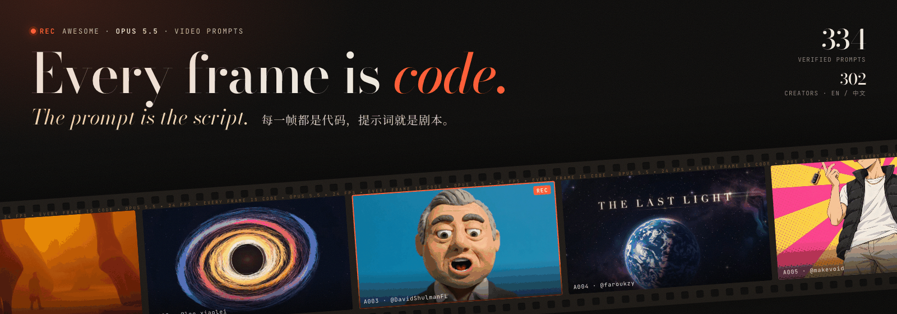

<div align="center">

<a href="https://li-evan.github.io/awesome-opus-5.5-video-prompts/?lang=zh"></a>

# Awesome Opus 5.5 Video Prompts [](https://awesome.re)

大家真正用 Claude Opus 5.5 做出视频的提示词，每一条都从作者本人的帖子里逐字摘录。

[English](README.md) · **简体中文**

**[▶ 打开在线画廊](https://li-evan.github.io/awesome-opus-5.5-video-prompts/?lang=zh)** · [导演工具箱](zh-CN/guide/director-toolkit.md) · [参与贡献](contributing.zh-CN.md)

</div>

**334 条提示词，来自 302 位创作者**。每条都有预览、原帖链接、英文或中文译文，以及用到的工具、需要的素材和作者自述的耗时成本。Opus 5.5 不直接生成画面，而是写代码画出每一帧，所以提示词就是完整的配方。

## 这个列表有什么不同

- **回原帖核实。** 每条提示词都从作者本人的帖子、串推或回复里摘录，并用程序逐字比对。不收转述，不从别人的合集里抄。
- **中英对照。** 每条提示词保留原文，同时附中文或英文译文。
- **不只是抄，还教你当导演。** 工具箱讲清楚好提示词的结构、能精确改动成片的镜头词汇，以及一句话出片后该怎么修。

## 目录

- [三分钟上手](#三分钟上手)
- [收藏最多的提示词](#收藏最多的提示词)
- [按分类浏览](#按分类浏览)
  - [🎬 动效与作品集](#-动效与作品集)
  - [🚀 产品发布与广告](#-产品发布与广告)
  - [🧠 科普与讲解](#-科普与讲解)
  - [📜 历史与纪录](#-历史与纪录)
  - [🎵 MV 与歌词动画](#-mv-与歌词动画)
  - [🎨 叙事、手绘与定格](#-叙事手绘与定格)
  - [🪞 让 Opus 讲自己](#-让-opus-讲自己)
  - [🧊 3D、着色器与世界](#-3d着色器与世界)
  - [🔁 改编与复刻](#-改编与复刻)
- [六步导演法](#六步导演法)
- [工具、Skill 与教程](#工具skill-与教程)
- [收录方法](#收录方法)
- [版权与下架](#版权与下架)
- [参与贡献](#参与贡献)

## 三分钟上手

Opus 5.5 本身不输出视频。它写代码画出每一帧（HTML Canvas、SVG、Three.js、Remotion、HyperFrames、Manim）， 在无头浏览器里逐帧渲染，再用 ffmpeg 合成 MP4。所以它擅长动效、科普讲解和发布片；想改哪里，是改一行代码重新渲染， 而不是重新抽卡。

1. 打开 Claude Code（或 Claude App），模型选 Opus 5.5，effort 调到 high 或 max。
2. 装一个渲染器，让它能直接出 MP4：`npx skills add heygen-com/hyperframes` 或 `npx skills add remotion-dev/skills`。本机需要 Node 22+、Chrome 和 ffmpeg。
3. 新建一个空文件夹，从本列表挑一条提示词粘进去，把主题、品牌和素材换成你自己的。
4. 正式渲染前，先让它每个场景出一张静帧；确认后再像导演一样给修改意见（见下方导演词汇表）。

**先试这三条**

- **带 3D 段落和自制配乐的作品集** ([@shneural](https://x.com/shneural) · 2026-09-24 · 🔖 6.2k · ▶ 1.7M · `一句话` · Blender · Python)

  ```text
  make a dynamic 15-second motion graphics video that shows what an incredible motion designer you are, like it's your showreel for a résumé. go all out.
  ```

- **什么是 Transformer** ([@dotey](https://x.com/dotey) · 2026-09-26 · 🔖 1.6k · ▶ 165.6k · `短描述` · Remotion · TTS)

  ```text
  帮我用js制作一个视频，主题是：什么是 Transformer
  要深入浅出，让高中生也能看得懂，不仅high level说的清楚，也要有细节，包括注意力机制，甚至一些数学概念

  你可以用任何工具或者安装工具，可以联网检索

  请给我惊喜
  ```

- **施法的像素风巫师** ([@majidmanzarpour](https://x.com/majidmanzarpour) · 2026-09-22 · 🔖 2.6k · ▶ 438.7k · `详细规格` · Canvas)

  ```text
  Create a single self-contained HTML file that renders an animated pixel art wizard casting a spell, using vanilla JavaScript and Canvas 2D. No external assets, libraries, or network requests.

  RENDERING
  - Draw everything to an offscreen canvas at a fixed logical resolution of 128x96, then blit to a fullscreen display canvas scaled by the largest integer factor that fits the window, centered, with imageSmoothingEnabled = false and CSS image-rendering: pixelated.
  - All drawing snaps to integer coordinates on the logical canvas. No sub-pixel positions, anti-aliasing, gradients, or shadowBlur.
  - Fixed palette of ~24 hex colors: deep blues/purples for night sky, warm robe tones, 3-4 bright magic colors. Every pixel comes from this palette.

  CHARACTER
  - Build the wizard procedurally from filled rects and pixel runs, ~24x32 logical pixels: pointed hat with a bend, long beard, two-shade robe with darker outline, staff with a gem at the tip.
  - Parameterize the pose (staff angle, arm raise, head tilt, robe sway). Animate parameters smoothly, then quantize to the pixel grid each frame so motion reads at an 8-12 fps pixel animation feel even though the loop runs at 60fps.

  ANIMATION
  - Looping state machine: IDLE (2-frame bob, beard sway) -> CHARGE (staff raises, gem flickers, sparks spiral inward) -> CAST (bright burst, projectile fires across the scene, 1-2 pixel screen shake) -> RECOVER (settle back). Ease pose parameters between keyframes.
  - Pooled allocation-free particle system: preallocate and reuse. Sparks orbit the gem during CHARGE, explode outward on CAST, each particle stepping its palette index from white to magic color to dark before despawn. Snap particle positions to the grid when drawing.
  - Fixed 60hz timestep update with rAF rendering. Zero object allocation inside the loop.

  SCENE
  - Minimal background: dark sky, a few twinkling 1px stars, moon, stone floor line. Character silhouette must read clearly.
  - Subtle 1px rim light on the wizard from the gem, brightening during CHARGE and CAST.

  QUALITY BAR
  - Crisp pixels at any window size, seamless loop, stable 60fps, readable silhouette. Should look like a polished 16-bit sprite animation, not vector shapes scaled down.
  ```

## 收藏最多的提示词

按原帖的收藏数排序。收藏数最能说明「我想拿来用」。

<table>
<tr>
<td width="33%" valign="top"><a href="https://github.com/Li-Evan/awesome-opus-5.5-video-prompts/blob/main/zh-CN/prompts/showreel.md#单个形状变形的-ui-动效循环"></a><br><b><a href="https://github.com/Li-Evan/awesome-opus-5.5-video-prompts/blob/main/zh-CN/prompts/showreel.md#单个形状变形的-ui-动效循环">单个形状变形的 UI 动效循环</a></b><br><sub>@twoclipping · 🔖 19.4k · ▶ 933.8k · 模板</sub><br>同一个形状踩着 120 BPM 变成按钮、播放器、滑块、图表等，首尾无缝循环的方形 UI 动效。</td><td width="33%" valign="top"><a href="https://github.com/Li-Evan/awesome-opus-5.5-video-prompts/blob/main/zh-CN/prompts/music.md#claude-pop-新版-mv"></a><br><b><a href="https://github.com/Li-Evan/awesome-opus-5.5-video-prompts/blob/main/zh-CN/prompts/music.md#claude-pop-新版-mv">Claude Pop 新版 MV</a></b><br><sub>@donaldjewkes · 🔖 8.9k · ▶ 2.8M · 多工具流程</sub><br>《Claude Pop》2.5 分钟新 MV：Seedance 打底，ElevenLabs 做音效，JS 画歌词动画。</td><td width="33%" valign="top"><a href="https://github.com/Li-Evan/awesome-opus-5.5-video-prompts/blob/main/zh-CN/prompts/showreel.md#带-3d-段落和自制配乐的作品集"></a><br><b><a href="https://github.com/Li-Evan/awesome-opus-5.5-video-prompts/blob/main/zh-CN/prompts/showreel.md#带-3d-段落和自制配乐的作品集">带 3D 段落和自制配乐的作品集</a></b><br><sub>@shneural · 🔖 6.2k · ▶ 1.7M · 一句话</sub><br>同一句作品集提示词，max 档；Opus 自己加了一段 Blender 3D，还写了 128 BPM 配乐。</td>
</tr>
<tr>
<td width="33%" valign="top"><a href="https://github.com/Li-Evan/awesome-opus-5.5-video-prompts/blob/main/zh-CN/prompts/launch.md#ai-推理创业公司的发布视频"></a><br><b><a href="https://github.com/Li-Evan/awesome-opus-5.5-video-prompts/blob/main/zh-CN/prompts/launch.md#ai-推理创业公司的发布视频">AI 推理创业公司的发布视频</a></b><br><sub>@deedydas · 🔖 4.7k · ▶ 338.8k · 一句话</sub><br>给 AI 推理创业公司做的 26 秒发布视频：写成网页动画后用 Playwright 录制，没用视频模型。</td><td width="33%" valign="top"><a href="https://github.com/Li-Evan/awesome-opus-5.5-video-prompts/blob/main/zh-CN/prompts/launch.md#苹果发布会风格的发布短片模板"></a><br><b><a href="https://github.com/Li-Evan/awesome-opus-5.5-video-prompts/blob/main/zh-CN/prompts/launch.md#苹果发布会风格的发布短片模板">苹果发布会风格的发布短片模板</a></b><br><sub>@twoclipping · 🔖 3.3k · ▶ 99.4k · 模板</sub><br>29 秒一镜到底的发布短片，每个场景都从上一个变形而来：液态玻璃、光圈转场、实拍墙面，全卡 120 BPM。</td><td width="33%" valign="top"><a href="https://github.com/Li-Evan/awesome-opus-5.5-video-prompts/blob/main/zh-CN/prompts/story.md#施法的像素风巫师"></a><br><b><a href="https://github.com/Li-Evan/awesome-opus-5.5-video-prompts/blob/main/zh-CN/prompts/story.md#施法的像素风巫师">施法的像素风巫师</a></b><br><sub>@majidmanzarpour · 🔖 2.6k · ▶ 438.7k · 详细规格</sub><br>无缝循环的 16 位像素动画：巫师蓄力、施法，用 Canvas 2D 以 128x96 程序化绘制。</td>
</tr>
<tr>
<td width="33%" valign="top"><a href="https://github.com/Li-Evan/awesome-opus-5.5-video-prompts/blob/main/zh-CN/prompts/launch.md#cosmos-发布视频"></a><br><b><a href="https://github.com/Li-Evan/awesome-opus-5.5-video-prompts/blob/main/zh-CN/prompts/launch.md#cosmos-发布视频">Cosmos 发布视频</a></b><br><sub>@kaolti · 🔖 1.8k · ▶ 64.7k · 多工具流程</sub><br>用 HyperFrames 做的 40 秒 Cosmos 发布视频：一条提示词调研并做出来，一条让它自查、刺激 5 倍。</td><td width="33%" valign="top"><a href="https://github.com/Li-Evan/awesome-opus-5.5-video-prompts/blob/main/zh-CN/prompts/explainer.md#什么是-transformer"></a><br><b><a href="https://github.com/Li-Evan/awesome-opus-5.5-video-prompts/blob/main/zh-CN/prompts/explainer.md#什么是-transformer">什么是 Transformer</a></b><br><sub>@dotey · 🔖 1.6k · ▶ 165.6k · 短描述</sub><br>给高中生讲 Transformer 和注意力机制的 12 分钟视频，xhigh 一次出片，配音用免费 Edge TTS。</td><td width="33%" valign="top"><a href="https://github.com/Li-Evan/awesome-opus-5.5-video-prompts/blob/main/zh-CN/prompts/explainer.md#一张图生成的鸡尾酒配方动画"></a><br><b><a href="https://github.com/Li-Evan/awesome-opus-5.5-video-prompts/blob/main/zh-CN/prompts/explainer.md#一张图生成的鸡尾酒配方动画">一张图生成的鸡尾酒配方动画</a></b><br><sub>@Ror_Fly · 🔖 1.4k · ▶ 73.6k · 短描述</sub><br>只给一张图，用 HTML 做出 30 秒的配方讲解动画，从空杯到调好，逐一展示倒入的原料和用量。</td>
</tr>
<tr>
<td width="33%" valign="top"><a href="https://github.com/Li-Evan/awesome-opus-5.5-video-prompts/blob/main/zh-CN/prompts/launch.md#极简风产品发布视频模板"></a><br><b><a href="https://github.com/Li-Evan/awesome-opus-5.5-video-prompts/blob/main/zh-CN/prompts/launch.md#极简风产品发布视频模板">极简风产品发布视频模板</a></b><br><sub>@twoclipping · 🔖 1.4k · ▶ 50.1k · 模板</sub><br>20 秒产品发布视频模板，卡 120 BPM 节拍，用你自己的竖屏素材，配遮罩文字和 3D 视频轮播。</td><td width="33%" valign="top"><a href="https://github.com/Li-Evan/awesome-opus-5.5-video-prompts/blob/main/zh-CN/prompts/worlds.md#巴黎雨夜像素风-lofi-循环"></a><br><b><a href="https://github.com/Li-Evan/awesome-opus-5.5-video-prompts/blob/main/zh-CN/prompts/worlds.md#巴黎雨夜像素风-lofi-循环">巴黎雨夜像素风 lofi 循环</a></b><br><sub>@minosdevs · 🔖 1.4k · ▶ 135.3k · 详细规格</sub><br>4 分钟无缝循环的巴黎雨夜像素画，有埃菲尔铁塔、塞纳河和飘落的欧元钞票，用作 lofi 视频背景。</td><td width="33%" valign="top"><a href="https://github.com/Li-Evan/awesome-opus-5.5-video-prompts/blob/main/zh-CN/prompts/showreel.md#max-档的动效简历短片"></a><br><b><a href="https://github.com/Li-Evan/awesome-opus-5.5-video-prompts/blob/main/zh-CN/prompts/showreel.md#max-档的动效简历短片">max 档的动效简历短片</a></b><br><sub>@darel023 · 🔖 1.1k · ▶ 66k · 短描述</sub><br>max 档做的 15 秒动效简历短片：第一秒给钩子，接着是字体、形状、镜头运动和色彩变化，节奏像卡着音乐剪。</td>
</tr>
</table>

## 按分类浏览

| | 分类 | 数量 |
|---|---|---:|
| 🎬 | [动效与作品集](zh-CN/prompts/showreel.md) | 48 |
| 🚀 | [产品发布与广告](zh-CN/prompts/launch.md) | 136 |
| 🧠 | [科普与讲解](zh-CN/prompts/explainer.md) | 31 |
| 📜 | [历史与纪录](zh-CN/prompts/history.md) | 20 |
| 🎵 | [MV 与歌词动画](zh-CN/prompts/music.md) | 18 |
| 🎨 | [叙事、手绘与定格](zh-CN/prompts/story.md) | 36 |
| 🪞 | [让 Opus 讲自己](zh-CN/prompts/self.md) | 16 |
| 🧊 | [3D、着色器与世界](zh-CN/prompts/worlds.md) | 15 |
| 🔁 | [改编与复刻](zh-CN/prompts/remix.md) | 14 |

### 🎬 动效与作品集

作品集、抽象动效、界面动效和动态文字。整个风潮就是从这里开始的。

<table>
<tr>
<td width="33%" valign="top"><a href="https://github.com/Li-Evan/awesome-opus-5.5-video-prompts/blob/main/zh-CN/prompts/showreel.md#单个形状变形的-ui-动效循环"></a><br><b><a href="https://github.com/Li-Evan/awesome-opus-5.5-video-prompts/blob/main/zh-CN/prompts/showreel.md#单个形状变形的-ui-动效循环">单个形状变形的 UI 动效循环</a></b><br><sub>@twoclipping · 🔖 19.4k · ▶ 933.8k · 模板</sub><br>同一个形状踩着 120 BPM 变成按钮、播放器、滑块、图表等，首尾无缝循环的方形 UI 动效。</td><td width="33%" valign="top"><a href="https://github.com/Li-Evan/awesome-opus-5.5-video-prompts/blob/main/zh-CN/prompts/showreel.md#带-3d-段落和自制配乐的作品集"></a><br><b><a href="https://github.com/Li-Evan/awesome-opus-5.5-video-prompts/blob/main/zh-CN/prompts/showreel.md#带-3d-段落和自制配乐的作品集">带 3D 段落和自制配乐的作品集</a></b><br><sub>@shneural · 🔖 6.2k · ▶ 1.7M · 一句话</sub><br>同一句作品集提示词，max 档；Opus 自己加了一段 Blender 3D，还写了 128 BPM 配乐。</td><td width="33%" valign="top"><a href="https://github.com/Li-Evan/awesome-opus-5.5-video-prompts/blob/main/zh-CN/prompts/showreel.md#max-档的动效简历短片"></a><br><b><a href="https://github.com/Li-Evan/awesome-opus-5.5-video-prompts/blob/main/zh-CN/prompts/showreel.md#max-档的动效简历短片">max 档的动效简历短片</a></b><br><sub>@darel023 · 🔖 1.1k · ▶ 66k · 短描述</sub><br>max 档做的 15 秒动效简历短片：第一秒给钩子，接着是字体、形状、镜头运动和色彩变化，节奏像卡着音乐剪。</td>
</tr>
<tr>
<td width="33%" valign="top"><a href="https://github.com/Li-Evan/awesome-opus-5.5-video-prompts/blob/main/zh-CN/prompts/showreel.md#手游高光时刻动效模板"></a><br><b><a href="https://github.com/Li-Evan/awesome-opus-5.5-video-prompts/blob/main/zh-CN/prompts/showreel.md#手游高光时刻动效模板">手游高光时刻动效模板</a></b><br><sub>@op7418 · 🔖 899 · ▶ 65.1k · 模板</sub><br>手游「高光时刻」动效模板，如开宝箱、段位晋升：Three.js 卡通 3D 主体、五段式演出、GSAP 编排。</td><td width="33%" valign="top"><a href="https://github.com/Li-Evan/awesome-opus-5.5-video-prompts/blob/main/zh-CN/prompts/showreel.md#创作者品牌动态文字片头"></a><br><b><a href="https://github.com/Li-Evan/awesome-opus-5.5-video-prompts/blob/main/zh-CN/prompts/showreel.md#创作者品牌动态文字片头">创作者品牌动态文字片头</a></b><br><sub>@techhalla · 🔖 329 · ▶ 30.4k · 详细规格</sub><br>20 秒可循环的 1080×1080 动态文字片头，黑底配洋红和荧光绿，逐字弹簧、蒙版擦除、套印错位。</td><td width="33%" valign="top"><a href="https://github.com/Li-Evan/awesome-opus-5.5-video-prompts/blob/main/zh-CN/prompts/showreel.md#配乐代码合成的动效作品集"></a><br><b><a href="https://github.com/Li-Evan/awesome-opus-5.5-video-prompts/blob/main/zh-CN/prompts/showreel.md#配乐代码合成的动效作品集">配乐代码合成的动效作品集</a></b><br><sub>@prasenx · 🔖 100 · ▶ 13k · 短描述</sub><br>「动效作品集」提示词加强版：配乐全用代码合成、剪辑踩拍、输出 1080p 60fps MP4，在 Cursor 里完成。</td>
</tr>
</table>

**[查看全部 48 条 →](zh-CN/prompts/showreel.md)**

### 🚀 产品发布与广告

发布片、App 与 SaaS 宣传片、品牌短片和广告。

<table>
<tr>
<td width="33%" valign="top"><a href="https://github.com/Li-Evan/awesome-opus-5.5-video-prompts/blob/main/zh-CN/prompts/launch.md#ai-推理创业公司的发布视频"></a><br><b><a href="https://github.com/Li-Evan/awesome-opus-5.5-video-prompts/blob/main/zh-CN/prompts/launch.md#ai-推理创业公司的发布视频">AI 推理创业公司的发布视频</a></b><br><sub>@deedydas · 🔖 4.7k · ▶ 338.8k · 一句话</sub><br>给 AI 推理创业公司做的 26 秒发布视频：写成网页动画后用 Playwright 录制，没用视频模型。</td><td width="33%" valign="top"><a href="https://github.com/Li-Evan/awesome-opus-5.5-video-prompts/blob/main/zh-CN/prompts/launch.md#苹果发布会风格的发布短片模板"></a><br><b><a href="https://github.com/Li-Evan/awesome-opus-5.5-video-prompts/blob/main/zh-CN/prompts/launch.md#苹果发布会风格的发布短片模板">苹果发布会风格的发布短片模板</a></b><br><sub>@twoclipping · 🔖 3.3k · ▶ 99.4k · 模板</sub><br>29 秒一镜到底的发布短片，每个场景都从上一个变形而来：液态玻璃、光圈转场、实拍墙面，全卡 120 BPM。</td><td width="33%" valign="top"><a href="https://github.com/Li-Evan/awesome-opus-5.5-video-prompts/blob/main/zh-CN/prompts/launch.md#cosmos-发布视频"></a><br><b><a href="https://github.com/Li-Evan/awesome-opus-5.5-video-prompts/blob/main/zh-CN/prompts/launch.md#cosmos-发布视频">Cosmos 发布视频</a></b><br><sub>@kaolti · 🔖 1.8k · ▶ 64.7k · 多工具流程</sub><br>用 HyperFrames 做的 40 秒 Cosmos 发布视频：一条提示词调研并做出来，一条让它自查、刺激 5 倍。</td>
</tr>
<tr>
<td width="33%" valign="top"><a href="https://github.com/Li-Evan/awesome-opus-5.5-video-prompts/blob/main/zh-CN/prompts/launch.md#极简风产品发布视频模板"></a><br><b><a href="https://github.com/Li-Evan/awesome-opus-5.5-video-prompts/blob/main/zh-CN/prompts/launch.md#极简风产品发布视频模板">极简风产品发布视频模板</a></b><br><sub>@twoclipping · 🔖 1.4k · ▶ 50.1k · 模板</sub><br>20 秒产品发布视频模板，卡 120 BPM 节拍，用你自己的竖屏素材，配遮罩文字和 3D 视频轮播。</td><td width="33%" valign="top"><a href="https://github.com/Li-Evan/awesome-opus-5.5-video-prompts/blob/main/zh-CN/prompts/launch.md#聚焦产品的动效视频模板"></a><br><b><a href="https://github.com/Li-Evan/awesome-opus-5.5-video-prompts/blob/main/zh-CN/prompts/launch.md#聚焦产品的动效视频模板">聚焦产品的动效视频模板</a></b><br><sub>@ann_nnng · 🔖 1.1k · ▶ 95.2k · 模板</sub><br>围绕你的产品做 15 秒动效视频：Opus 先去看产品页面，再自己写视频内容。作者用的是 Claude Code。</td><td width="33%" valign="top"><a href="https://github.com/Li-Evan/awesome-opus-5.5-video-prompts/blob/main/zh-CN/prompts/launch.md#自选-saas-的产品发布视频"></a><br><b><a href="https://github.com/Li-Evan/awesome-opus-5.5-video-prompts/blob/main/zh-CN/prompts/launch.md#自选-saas-的产品发布视频">自选 SaaS 的产品发布视频</a></b><br><sub>@moritzkremb · 🔖 946 · ▶ 88.8k · 短描述</sub><br>Opus 自己挑一个知名 SaaS，从网上找真实素材，剪出 46 秒的发布视频，用 HyperFrames 做成。</td>
</tr>
</table>

**[查看全部 136 条 →](zh-CN/prompts/launch.md)**

### 🧠 科普与讲解

科学、数学、技术和原理讲解，常用 Manim 或配旁白。

<table>
<tr>
<td width="33%" valign="top"><a href="https://github.com/Li-Evan/awesome-opus-5.5-video-prompts/blob/main/zh-CN/prompts/explainer.md#什么是-transformer"></a><br><b><a href="https://github.com/Li-Evan/awesome-opus-5.5-video-prompts/blob/main/zh-CN/prompts/explainer.md#什么是-transformer">什么是 Transformer</a></b><br><sub>@dotey · 🔖 1.6k · ▶ 165.6k · 短描述</sub><br>给高中生讲 Transformer 和注意力机制的 12 分钟视频，xhigh 一次出片，配音用免费 Edge TTS。</td><td width="33%" valign="top"><a href="https://github.com/Li-Evan/awesome-opus-5.5-video-prompts/blob/main/zh-CN/prompts/explainer.md#一张图生成的鸡尾酒配方动画"></a><br><b><a href="https://github.com/Li-Evan/awesome-opus-5.5-video-prompts/blob/main/zh-CN/prompts/explainer.md#一张图生成的鸡尾酒配方动画">一张图生成的鸡尾酒配方动画</a></b><br><sub>@Ror_Fly · 🔖 1.4k · ▶ 73.6k · 短描述</sub><br>只给一张图，用 HTML 做出 30 秒的配方讲解动画，从空杯到调好，逐一展示倒入的原料和用量。</td><td width="33%" valign="top"><a href="https://github.com/Li-Evan/awesome-opus-5.5-video-prompts/blob/main/zh-CN/prompts/explainer.md#线稿风大气环流地理课"></a><br><b><a href="https://github.com/Li-Evan/awesome-opus-5.5-video-prompts/blob/main/zh-CN/prompts/explainer.md#线稿风大气环流地理课">线稿风「大气环流」地理课</a></b><br><sub>@akokoi1 · 🔖 808 · ▶ 134.5k · 短描述</sub><br>近 5 分钟的线稿风高中地理课，讲「大气环流」，中英双语字幕加配乐，TTS 解说通过 TTS.md 和 .env 接入。</td>
</tr>
<tr>
<td width="33%" valign="top"><a href="https://github.com/Li-Evan/awesome-opus-5.5-video-prompts/blob/main/zh-CN/prompts/explainer.md#加密如何保护文件传输"></a><br><b><a href="https://github.com/Li-Evan/awesome-opus-5.5-video-prompts/blob/main/zh-CN/prompts/explainer.md#加密如何保护文件传输">加密如何保护文件传输</a></b><br><sub>@SyntaxDiffusion · 🔖 567 · ▶ 35.5k · 一句话</sub><br>96 秒的加密文件传输可视化讲解，在 Sentinel 环境里完成，音效全用 Python 合成、ffmpeg 混音。</td><td width="33%" valign="top"><a href="https://github.com/Li-Evan/awesome-opus-5.5-video-prompts/blob/main/zh-CN/prompts/explainer.md#manim-导数概念教学视频"></a><br><b><a href="https://github.com/Li-Evan/awesome-opus-5.5-video-prompts/blob/main/zh-CN/prompts/explainer.md#manim-导数概念教学视频">Manim 导数概念教学视频</a></b><br><sub>@LinearUncle · 🔖 360 · ▶ 22k · 一句话</sub><br>7 分半的 Manim 导数入门课，带例子讲解，配音用 edge-tts。</td><td width="33%" valign="top"><a href="https://github.com/Li-Evan/awesome-opus-5.5-video-prompts/blob/main/zh-CN/prompts/explainer.md#九种画风讲递归"></a><br><b><a href="https://github.com/Li-Evan/awesome-opus-5.5-video-prompts/blob/main/zh-CN/prompts/explainer.md#九种画风讲递归">九种画风讲递归</a></b><br><sub>@emollick · 🔖 275 · ▶ 61.1k · 一句话</sub><br>75 秒自我指涉的递归讲解，画风切换九次；画面用 React 和 SVG 绘制，音乐音效用 Python 合成。</td>
</tr>
</table>

**[查看全部 31 条 →](zh-CN/prompts/explainer.md)**

### 📜 历史与纪录

用动画讲时间线、文明、战役和人物传记。

<table>
<tr>
<td width="33%" valign="top"><a href="https://github.com/Li-Evan/awesome-opus-5.5-video-prompts/blob/main/zh-CN/prompts/history.md#奥斯特里茨战役-5-分钟电影"></a><br><b><a href="https://github.com/Li-Evan/awesome-opus-5.5-video-prompts/blob/main/zh-CN/prompts/history.md#奥斯特里茨战役-5-分钟电影">奥斯特里茨战役 5 分钟电影</a></b><br><sub>@WinterArc2125 · 🔖 1k · ▶ 394.5k · 短描述</sub><br>用代码渲染的 5 分钟奥斯特里茨战役电影，地形来自真实卫星数据，日出位置按史实，配乐和旁白也是它自己做的。</td><td width="33%" valign="top"><a href="https://github.com/Li-Evan/awesome-opus-5.5-video-prompts/blob/main/zh-CN/prompts/history.md#1906-年旧金山市场街复原"></a><br><b><a href="https://github.com/Li-Evan/awesome-opus-5.5-video-prompts/blob/main/zh-CN/prompts/history.md#1906-年旧金山市场街复原">1906 年旧金山市场街复原</a></b><br><sub>@alexalbert__ · 🔖 418 · ▶ 147.2k · 详细规格</sub><br>用 Blender Python 按保险地图、老影片和旧照片复原 1906 年地震前的旧金山市场街，沿街推进 10 秒。</td><td width="33%" valign="top"><a href="https://github.com/Li-Evan/awesome-opus-5.5-video-prompts/blob/main/zh-CN/prompts/history.md#沙画动画讲美国-250-年"></a><br><b><a href="https://github.com/Li-Evan/awesome-opus-5.5-video-prompts/blob/main/zh-CN/prompts/history.md#沙画动画讲美国-250-年">沙画动画讲美国 250 年</a></b><br><sub>@Michaelzsguo · 🔖 353 · ▶ 71.4k · 一句话</sub><br>2 分钟沙画动画讲美国 250 年历史，带配乐音效，纯代码生成，没用 Blender 或 Three.js。</td>
</tr>
<tr>
<td width="33%" valign="top"><a href="https://github.com/Li-Evan/awesome-opus-5.5-video-prompts/blob/main/zh-CN/prompts/history.md#从人类诞生到-opus-55"></a><br><b><a href="https://github.com/Li-Evan/awesome-opus-5.5-video-prompts/blob/main/zh-CN/prompts/history.md#从人类诞生到-opus-55">从人类诞生到 Opus 5.5</a></b><br><sub>@songkeys · 🔖 212 · ▶ 35.2k · 短描述</sub><br>108 秒折纸涂鸦动画，从人类诞生讲到孵出 AI 和 Opus 5.5，几乎无字，纯 JavaScript 实现。</td><td width="33%" valign="top"><a href="https://github.com/Li-Evan/awesome-opus-5.5-video-prompts/blob/main/zh-CN/prompts/history.md#中华文明史史诗编年片"></a><br><b><a href="https://github.com/Li-Evan/awesome-opus-5.5-video-prompts/blob/main/zh-CN/prompts/history.md#中华文明史史诗编年片">《中华文明史》史诗编年片</a></b><br><sub>@dotey · 🔖 212 · ▶ 25.5k · 短描述</sub><br>3 分半的中华文明编年片，宣纸白描与玄底泥金两种画风交替，五声调式配乐的 BPM 随朝代加快。</td><td width="33%" valign="top"><a href="https://github.com/Li-Evan/awesome-opus-5.5-video-prompts/blob/main/zh-CN/prompts/history.md#1-分钟看完印尼-81-年历史"></a><br><b><a href="https://github.com/Li-Evan/awesome-opus-5.5-video-prompts/blob/main/zh-CN/prompts/history.md#1-分钟看完印尼-81-年历史">1 分钟看完印尼 81 年历史</a></b><br><sub>@hanifproduktif · 🔖 120 · ▶ 9.9k · 一句话</sub><br>59 秒线描动画，轻松有趣地回顾印尼 81 年的历史，配音乐和 ElevenLabs 旁白。</td>
</tr>
</table>

**[查看全部 20 条 →](zh-CN/prompts/history.md)**

### 🎵 MV 与歌词动画

MV、歌词视频和跟着音乐律动的作品，很多连配乐都是生成的。

<table>
<tr>
<td width="33%" valign="top"><a href="https://github.com/Li-Evan/awesome-opus-5.5-video-prompts/blob/main/zh-CN/prompts/music.md#claude-pop-新版-mv"></a><br><b><a href="https://github.com/Li-Evan/awesome-opus-5.5-video-prompts/blob/main/zh-CN/prompts/music.md#claude-pop-新版-mv">Claude Pop 新版 MV</a></b><br><sub>@donaldjewkes · 🔖 8.9k · ▶ 2.8M · 多工具流程</sub><br>《Claude Pop》2.5 分钟新 MV：Seedance 打底，ElevenLabs 做音效，JS 画歌词动画。</td><td width="33%" valign="top"><a href="https://github.com/Li-Evan/awesome-opus-5.5-video-prompts/blob/main/zh-CN/prompts/music.md#90-年代-demoscene"></a><br><b><a href="https://github.com/Li-Evan/awesome-opus-5.5-video-prompts/blob/main/zh-CN/prompts/music.md#90-年代-demoscene">90 年代 demoscene</a></b><br><sub>@gandamu_ml · 🔖 358 · ▶ 37.5k · 短描述</sub><br>C/C++ 加 OpenGL 实时渲染的 90 年代 demoscene，约 6 分钟，特效卡着作者给的 S3M 配乐。</td><td width="33%" valign="top"><a href="https://github.com/Li-Evan/awesome-opus-5.5-video-prompts/blob/main/zh-CN/prompts/music.md#15-秒动态文字-mv"></a><br><b><a href="https://github.com/Li-Evan/awesome-opus-5.5-video-prompts/blob/main/zh-CN/prompts/music.md#15-秒动态文字-mv">15 秒动态文字 MV</a></b><br><sub>@itnavi2022 · 🔖 231 · ▶ 15.5k · 一句话</sub><br>15 秒动态文字 MV，文字随音乐起舞，全程只用 Opus 5.5。</td>
</tr>
<tr>
<td width="33%" valign="top"><b><a href="https://github.com/Li-Evan/awesome-opus-5.5-video-prompts/blob/main/zh-CN/prompts/music.md#笔触画的-rick-astley">笔触画的 Rick Astley</a></b><br><sub>@petergostev · 🔖 158 · ▶ 11.3k · 短描述</sub><br>约 1 分钟的 HTML 动画，用流动的粗笔触重现 Rick Astley 的舞步，配乐也由代码生成。</td><td width="33%" valign="top"><a href="https://github.com/Li-Evan/awesome-opus-5.5-video-prompts/blob/main/zh-CN/prompts/music.md#塞满-ai-梗的-mv"></a><br><b><a href="https://github.com/Li-Evan/awesome-opus-5.5-video-prompts/blob/main/zh-CN/prompts/music.md#塞满-ai-梗的-mv">塞满 AI 梗的 MV</a></b><br><sub>@doubleunplussed · 🔖 93 · ▶ 24.6k · 短描述</sub><br>4 分多钟的 MV，给一首 Suno 的 AI 主题歌配画面，塞满 AI 安全圈的梗，风格参照现成的代码动画。</td><td width="33%" valign="top"><a href="https://github.com/Li-Evan/awesome-opus-5.5-video-prompts/blob/main/zh-CN/prompts/music.md#诡异披萨店音乐-mv"></a><br><b><a href="https://github.com/Li-Evan/awesome-opus-5.5-video-prompts/blob/main/zh-CN/prompts/music.md#诡异披萨店音乐-mv">诡异披萨店音乐 MV</a></b><br><sub>@ParanoidAmerica · 🔖 18 · ▶ 7.6k · 短描述</sub><br>2 分 21 秒、按歌词同步的 MV，拼贴风混圆珠笔速写；画面由 Opus 调本地 ComfyUI 和 SDXL 生成。</td>
</tr>
</table>

**[查看全部 18 条 →](zh-CN/prompts/music.md)**

### 🎨 叙事、手绘与定格

叙事短片、线稿、定格动画和诗。

<table>
<tr>
<td width="33%" valign="top"><a href="https://github.com/Li-Evan/awesome-opus-5.5-video-prompts/blob/main/zh-CN/prompts/story.md#施法的像素风巫师"></a><br><b><a href="https://github.com/Li-Evan/awesome-opus-5.5-video-prompts/blob/main/zh-CN/prompts/story.md#施法的像素风巫师">施法的像素风巫师</a></b><br><sub>@majidmanzarpour · 🔖 2.6k · ▶ 438.7k · 详细规格</sub><br>无缝循环的 16 位像素动画：巫师蓄力、施法，用 Canvas 2D 以 128x96 程序化绘制。</td><td width="33%" valign="top"><a href="https://github.com/Li-Evan/awesome-opus-5.5-video-prompts/blob/main/zh-CN/prompts/story.md#会飞起来的玻璃金箔马赛克"></a><br><b><a href="https://github.com/Li-Evan/awesome-opus-5.5-video-prompts/blob/main/zh-CN/prompts/story.md#会飞起来的玻璃金箔马赛克">会飞起来的玻璃金箔马赛克</a></b><br><sub>@LCSlates · 🔖 867 · ▶ 128.7k · 短描述</sub><br>80 秒方形 WebGL2 短片：玻璃金箔马赛克的瓷片飞起，聚成鱼、仙鹤和星座，再咔嗒归位，声音在浏览器里合成。</td><td width="33%" valign="top"><a href="https://github.com/Li-Evan/awesome-opus-5.5-video-prompts/blob/main/zh-CN/prompts/story.md#太空中闪避陨石的像素小人"></a><br><b><a href="https://github.com/Li-Evan/awesome-opus-5.5-video-prompts/blob/main/zh-CN/prompts/story.md#太空中闪避陨石的像素小人">太空中闪避陨石的像素小人</a></b><br><sub>@riku720720 · 🔖 844 · ▶ 240.9k · 详细规格</sub><br>无缝循环的 16 位风格演示：橙色像素小人在太空彩虹地板上狂奔，自动闪避陨石和光束。</td>
</tr>
<tr>
<td width="33%" valign="top"><a href="https://github.com/Li-Evan/awesome-opus-5.5-video-prompts/blob/main/zh-CN/prompts/story.md#有故事和对白的-2d-动画短片"></a><br><b><a href="https://github.com/Li-Evan/awesome-opus-5.5-video-prompts/blob/main/zh-CN/prompts/story.md#有故事和对白的-2d-动画短片">有故事和对白的 2D 动画短片</a></b><br><sub>@ALSK_ai · 🔖 778 · ▶ 99.7k · 一句话</sub><br>60 秒 2D 动画短片，有故事和对白，配乐音效都用代码生成；作者把时长改成 1 分钟、agent 改成 10 个。</td><td width="33%" valign="top"><a href="https://github.com/Li-Evan/awesome-opus-5.5-video-prompts/blob/main/zh-CN/prompts/story.md#35-秒反转短剧"></a><br><b><a href="https://github.com/Li-Evan/awesome-opus-5.5-video-prompts/blob/main/zh-CN/prompts/story.md#35-秒反转短剧">35 秒反转短剧</a></b><br><sub>@AI_DVD6 · 🔖 466 · ▶ 70.3k · 多工具流程</sub><br>35 秒中文反转短剧：Opus 先出故事方案并选定，再一步步带新手在剪映里生成镜头、剪成成片。</td><td width="33%" valign="top"><a href="https://github.com/Li-Evan/awesome-opus-5.5-video-prompts/blob/main/zh-CN/prompts/story.md#bbc-腔的硅基自然动画"></a><br><b><a href="https://github.com/Li-Evan/awesome-opus-5.5-video-prompts/blob/main/zh-CN/prompts/story.md#bbc-腔的硅基自然动画">BBC 腔的“硅基自然”动画</a></b><br><sub>@Tz_2022 · 🔖 221 · ▶ 47.3k · 一句话</sub><br>近 8 分钟的 2D 仿自然纪录片动画，BBC 腔英文旁白、中英双语字幕，素材是作者写的开发者“迁徙”讽刺文。</td>
</tr>
</table>

**[查看全部 36 条 →](zh-CN/prompts/story.md)**

### 🪞 让 Opus 讲自己

让 Claude 讲自己是什么、怎么看世界、做 Claude 是什么感觉。

<table>
<tr>
<td width="33%" valign="top"><a href="https://github.com/Li-Evan/awesome-opus-5.5-video-prompts/blob/main/zh-CN/prompts/self.md#关于-claude-的电影片头"></a><br><b><a href="https://github.com/Li-Evan/awesome-opus-5.5-video-prompts/blob/main/zh-CN/prompts/self.md#关于-claude-的电影片头">关于 Claude 的电影片头</a></b><br><sub>@goodside · 🔖 196 · ▶ 57.7k · 一句话</sub><br>为一部虚构的「关于你」的电影做 75 秒片头字幕，人名全是编的；模型选了致敬几位导演的风格，直接交付 MP4。</td><td width="33%" valign="top"><a href="https://github.com/Li-Evan/awesome-opus-5.5-video-prompts/blob/main/zh-CN/prompts/self.md#claude-小人拍动作片"></a><br><b><a href="https://github.com/Li-Evan/awesome-opus-5.5-video-prompts/blob/main/zh-CN/prompts/self.md#claude-小人拍动作片">Claude 小人拍动作片</a></b><br><sub>@daniel_mac8 · 🔖 183 · ▶ 14.2k · 短描述</sub><br>给 X 帖子配的 30 秒动画：Claude Code 终端炸开，一群 Claude 小人在拍动作片，风格照参考视频。</td><td width="33%" valign="top"><a href="https://github.com/Li-Evan/awesome-opus-5.5-video-prompts/blob/main/zh-CN/prompts/self.md#claude-的私人速写本"></a><br><b><a href="https://github.com/Li-Evan/awesome-opus-5.5-video-prompts/blob/main/zh-CN/prompts/self.md#claude-的私人速写本">Claude 的私人速写本</a></b><br><sub>@kloss_xyz · 🔖 86 · ▶ 7.1k · 详细规格</sub><br>2 分半的速写本翻阅视频：20 页写满 Claude 的心事和自创笔迹，Three.js 翻页，钢琴配乐代码合成。</td>
</tr>
<tr>
<td width="33%" valign="top"><a href="https://github.com/Li-Evan/awesome-opus-5.5-video-prompts/blob/main/zh-CN/prompts/self.md#opus-55-剪中秋短视频"></a><br><b><a href="https://github.com/Li-Evan/awesome-opus-5.5-video-prompts/blob/main/zh-CN/prompts/self.md#opus-55-剪中秋短视频">Opus 5.5 剪中秋短视频</a></b><br><sub>@Gorden_Sun · 🔖 74 · ▶ 8k · 短描述</sub><br>一镜到底的动画：Opus 5.5 在类似剪映的流程里剪一条中秋短视频，自己作电子乐并卡点。</td><td width="33%" valign="top"><a href="https://github.com/Li-Evan/awesome-opus-5.5-video-prompts/blob/main/zh-CN/prompts/self.md#opus-55-自我宣传动画"></a><br><b><a href="https://github.com/Li-Evan/awesome-opus-5.5-video-prompts/blob/main/zh-CN/prompts/self.md#opus-55-自我宣传动画">Opus 5.5 自我宣传动画</a></b><br><sub>@0xLogicrw · 🔖 68 · ▶ 20.9k · 一句话</sub><br>Opus 5.5 给自己做的宣传动画，全用 JavaScript 绘制并配背景音乐，原帖与 GPT 6 Sol 版对比。</td><td width="33%" valign="top"><a href="https://github.com/Li-Evan/awesome-opus-5.5-video-prompts/blob/main/zh-CN/prompts/self.md#claude-吉祥物游哥伦比亚"></a><br><b><a href="https://github.com/Li-Evan/awesome-opus-5.5-video-prompts/blob/main/zh-CN/prompts/self.md#claude-吉祥物游哥伦比亚">Claude 吉祥物游哥伦比亚</a></b><br><sub>@alarcon7a · 🔖 55 · ▶ 14.3k · 短描述</sub><br>30 秒纯代码动画，Claude 吉祥物走过哥伦比亚的几处地标，一路展示搜索、数据分析和写代码的能力。</td>
</tr>
</table>

**[查看全部 16 条 →](zh-CN/prompts/self.md)**

### 🧊 3D、着色器与世界

3D 场景、镜头穿梭、模拟、着色器和宇宙尺度缩放。

<table>
<tr>
<td width="33%" valign="top"><a href="https://github.com/Li-Evan/awesome-opus-5.5-video-prompts/blob/main/zh-CN/prompts/worlds.md#巴黎雨夜像素风-lofi-循环"></a><br><b><a href="https://github.com/Li-Evan/awesome-opus-5.5-video-prompts/blob/main/zh-CN/prompts/worlds.md#巴黎雨夜像素风-lofi-循环">巴黎雨夜像素风 lofi 循环</a></b><br><sub>@minosdevs · 🔖 1.4k · ▶ 135.3k · 详细规格</sub><br>4 分钟无缝循环的巴黎雨夜像素画，有埃菲尔铁塔、塞纳河和飘落的欧元钞票，用作 lofi 视频背景。</td><td width="33%" valign="top"><a href="https://github.com/Li-Evan/awesome-opus-5.5-video-prompts/blob/main/zh-CN/prompts/worlds.md#穿过复古物件的无限缩放"></a><br><b><a href="https://github.com/Li-Evan/awesome-opus-5.5-video-prompts/blob/main/zh-CN/prompts/worlds.md#穿过复古物件的无限缩放">穿过复古物件的无限缩放</a></b><br><sub>@koldo2k · 🔖 933 · ▶ 67.5k · 多工具流程</sub><br>20 秒无缝循环的无限缩放，穿过怀表、放大镜等复古物件飞进下一片风景，素材都经 Magnific MCP 生成。</td><td width="33%" valign="top"><a href="https://github.com/Li-Evan/awesome-opus-5.5-video-prompts/blob/main/zh-CN/prompts/worlds.md#由一个词生成的宇宙诞生动画"></a><br><b><a href="https://github.com/Li-Evan/awesome-opus-5.5-video-prompts/blob/main/zh-CN/prompts/worlds.md#由一个词生成的宇宙诞生动画">由一个词生成的宇宙诞生动画</a></b><br><sub>@MiaAI_lab · 🔖 747 · ▶ 75.3k · 一句话</sub><br>输入一个词就生成一整个宇宙的实时视听作品：星星、星系、行星都用着色器画，Web Audio 实时出音乐，不用素材文件。</td>
</tr>
<tr>
<td width="33%" valign="top"><a href="https://github.com/Li-Evan/awesome-opus-5.5-video-prompts/blob/main/zh-CN/prompts/worlds.md#从小生物到宇宙的变形之旅"></a><br><b><a href="https://github.com/Li-Evan/awesome-opus-5.5-video-prompts/blob/main/zh-CN/prompts/worlds.md#从小生物到宇宙的变形之旅">从小生物到宇宙的变形之旅</a></b><br><sub>@leo_xiaolei · 🔖 140 · ▶ 18.5k · 详细规格</sub><br>30 秒手绘风 Canvas 动画，照参考视频风格，从小生物形变到神经元、棱镜、向日葵、星系、黑洞、地出。</td><td width="33%" valign="top"><a href="https://github.com/Li-Evan/awesome-opus-5.5-video-prompts/blob/main/zh-CN/prompts/worlds.md#它能做出的最好的水模拟"></a><br><b><a href="https://github.com/Li-Evan/awesome-opus-5.5-video-prompts/blob/main/zh-CN/prompts/worlds.md#它能做出的最好的水模拟">它能做出的最好的水模拟</a></b><br><sub>@Avenoxai · 🔖 124 · ▶ 39.9k · 一句话</sub><br>直播时用一句土耳其语提示词做的水模拟，帖子里展示的是 Opus 做出的三个模拟之一。</td><td width="33%" valign="top"><a href="https://github.com/Li-Evan/awesome-opus-5.5-video-prompts/blob/main/zh-CN/prompts/worlds.md#光线步进渲染的鹈鹕骑车"></a><br><b><a href="https://github.com/Li-Evan/awesome-opus-5.5-video-prompts/blob/main/zh-CN/prompts/worlds.md#光线步进渲染的鹈鹕骑车">光线步进渲染的鹈鹕骑车</a></b><br><sub>@AxtonLiu · 🔖 57 · ▶ 10k · 短描述</sub><br>38 秒「鹈鹕骑自行车」短片，Opus 自写 GPU 光线步进渲染器，栈桥、海面、天空和配乐全由代码生成。</td>
</tr>
</table>

**[查看全部 15 条 →](zh-CN/prompts/worlds.md)**

### 🔁 改编与复刻

把现成的视频、截图、照片或参考片改成新作品。

<table>
<tr>
<td width="33%" valign="top"><a href="https://github.com/Li-Evan/awesome-opus-5.5-video-prompts/blob/main/zh-CN/prompts/remix.md#伏尼契手稿短片的动漫风重制"></a><br><b><a href="https://github.com/Li-Evan/awesome-opus-5.5-video-prompts/blob/main/zh-CN/prompts/remix.md#伏尼契手稿短片的动漫风重制">伏尼契手稿短片的动漫风重制</a></b><br><sub>@emollick · 🔖 642 · ▶ 98.8k · 一句话</sub><br>追加一句提示词，把 Claude 自己做的伏尼契手稿讲解片重做成 2 分钟动漫风快剪版，结尾还有一首歌。</td><td width="33%" valign="top"><a href="https://github.com/Li-Evan/awesome-opus-5.5-video-prompts/blob/main/zh-CN/prompts/remix.md#口播素材剪成快节奏短片"></a><br><b><a href="https://github.com/Li-Evan/awesome-opus-5.5-video-prompts/blob/main/zh-CN/prompts/remix.md#口播素材剪成快节奏短片">口播素材剪成快节奏短片</a></b><br><sub>@sab8a · 🔖 581 · ▶ 60.7k · 一句话</sub><br>把一段原始口播素材剪成 37 秒快节奏成片，带字幕、图形和音乐，用 Opus 5.5 加开源 OpenEdit。</td><td width="33%" valign="top"><a href="https://github.com/Li-Evan/awesome-opus-5.5-video-prompts/blob/main/zh-CN/prompts/remix.md#真人口播改线稿动画"></a><br><b><a href="https://github.com/Li-Evan/awesome-opus-5.5-video-prompts/blob/main/zh-CN/prompts/remix.md#真人口播改线稿动画">真人口播改线稿动画</a></b><br><sub>@AxtonLiu · 🔖 411 · ▶ 31.6k · 短描述</sub><br>83 秒竖屏口播改成线稿动画 B-roll，真人缩到右下角圆形画中画；线稿由 Opus 用 Python 逐帧画出。</td>
</tr>
<tr>
<td width="33%" valign="top"><a href="https://github.com/Li-Evan/awesome-opus-5.5-video-prompts/blob/main/zh-CN/prompts/remix.md#原始素材剪成快节奏短视频"></a><br><b><a href="https://github.com/Li-Evan/awesome-opus-5.5-video-prompts/blob/main/zh-CN/prompts/remix.md#原始素材剪成快节奏短视频">原始素材剪成快节奏短视频</a></b><br><sub>@sab8a · 🔖 302 · ▶ 24.2k · 一句话</sub><br>用 Open Edit 把原始素材剪成 20 秒社媒短视频：删掉停顿和口头禅，按参考样式加字幕，配图形和音乐。</td><td width="33%" valign="top"><a href="https://github.com/Li-Evan/awesome-opus-5.5-video-prompts/blob/main/zh-CN/prompts/remix.md#临摹蒙娜丽莎的过程回放"></a><br><b><a href="https://github.com/Li-Evan/awesome-opus-5.5-video-prompts/blob/main/zh-CN/prompts/remix.md#临摹蒙娜丽莎的过程回放">临摹蒙娜丽莎的过程回放</a></b><br><sub>@ehsanik · 🔖 42 · ▶ 27.8k · 多工具流程</sub><br>31 秒回放：Opus 先操控 Chrome 在 JS Paint 里一笔笔画出蒙娜丽莎，再按追问把过程做成视频。</td><td width="33%" valign="top"><a href="https://github.com/Li-Evan/awesome-opus-5.5-video-prompts/blob/main/zh-CN/prompts/remix.md#给播客成片插满讲解动画"></a><br><b><a href="https://github.com/Li-Evan/awesome-opus-5.5-video-prompts/blob/main/zh-CN/prompts/remix.md#给播客成片插满讲解动画">给播客成片插满讲解动画</a></b><br><sub>@stokebuilder · 🔖 19 · ▶ 1.7k · 多工具流程</sub><br>多 Agent 流程：在播客成片中找 35–50 处，插入统一品牌的全屏 HyperFrames 动画，保留画中画。</td>
</tr>
</table>

**[查看全部 14 条 →](zh-CN/prompts/remix.md)**

## 六步导演法

改写自 @rexan_wong 的串推。他逆向拆解了一批号称「一句 prompt」的爆款视频。 [↗](https://x.com/rexan_wong/status/2103707054108299437)

| # | 步骤 | 怎么做 |
|---|---|---|
| 1 | **选参考片** | 挑一两条你想要的节奏和字体风格的视频，让 Opus 照着做。点名一种风格，比描述一种风格好用得多。没有参考，它会退回默认样子：居中文字、渐变背景、所有东西淡入。 |
| 2 | **装渲染器** | 装 HyperFrames 或 Remotion，它就能把每个场景写成代码、直接渲染成 MP4。每一帧都是确定的，改一处只动一行，不用推倒重来。 |
| 3 | **用真素材** | 给它你的真实截图、Logo 和界面组件，别让它自己编按钮和卡片。编出来的界面，是视频看起来廉价的开始。 |
| 4 | **一次给足上下文，要三版分镜** | 品牌、配色、字体、截图、参考片，再口述一遍你脑子里的片子。要三版分镜，你是在挑方向，而不是去修它的第一个想法。 |
| 5 | **先审静帧，再动起来** | 每个场景先出一张静帧。改分镜只要几秒，改成片就得重新渲染。 |
| 6 | **像导演一样给意见** | 第一版通常已经完成了大半。「再好一点」只会换来随机改动，用镜头语言才能精确改到你想要的地方。 |

### 导演词汇表

别再说「再好一点」，换成这些词。每一个都对应 Opus 能在代码里做出的具体改动。

| 术语 | 你想要 | 这样说 |
|---|---|---|
| `push in` | 强调某个元素 | 镜头往按钮推近，用 0.8 秒。 |
| `pull out` | 揭示全貌 | 从图表局部开始，拉远到整页。 |
| `hard cut on the beat` | 换场卡在节拍上 | 这里硬切，落在第 17 拍。 |
| `match cut / morph` | 场景之间连贯 | 上一镜的圆直接变成下一镜的 logo。 |
| `one continuous take` | 去掉幻灯片感 | 全程不切镜，每个场景都从上一个场景里长出来。 |
| `hold` | 让人读完字 | 这句话停 1.5 秒再走。 |
| `slow to 0.7x` | 太快太躁 | 所有缩放放慢到 0.7 倍。 |
| `stagger` | 元素一起蹦出来太乱 | 卡片依次进场，间隔 80 毫秒。 |

[完整工具箱里还有 10 个词 →](zh-CN/guide/director-toolkit.md)

### 一句话默认病体检表

拿到第一版成片后，先对照这张表体检，再提修改意见。 七个症状来自 @DavidKPiano，对应的改法是本列表整理的。 [↗](https://x.com/DavidKPiano/status/2103919227853783445)

- [ ] 节奏太快。 → 所有运动放慢到 0.7 倍，关键文字至少停留 1 秒。
- [ ] 特效太多。 → 在提示词里加禁用清单（发光、粒子、淡入淡出、渐变）。
- [ ] 没有整体感，东西往各个方向乱动。 → 每个场景只保留一个运动方向，或者要求一镜到底。
- [ ] 没有视觉焦点。 → 说清每个场景只讲一件事，然后推近它。
- [ ] 缓动千篇一律。 → 改用轻微回弹的弹簧动画，不同元素用不同节奏。
- [ ] 没有编排。 → 给它一张节拍网格，每一拍只安排一个变化。
- [ ] 为动而动。 → 告诉它每个动作要说明什么，比如「柱子变高，表示收入翻倍」。

**[查看完整工具箱 →](zh-CN/guide/director-toolkit.md)**

## 工具、Skill 与教程

### 渲染器与框架

- [HyperFrames](https://github.com/heygen-com/hyperframes) ⭐ 53.5k - HeyGen 开源的 HTML 转视频渲染器，专为 Agent 设计。场景用 HTML/CSS/GSAP 写，无头 Chrome 逐帧截图，ffmpeg 编码。用 `npx skills add heygen-com/hyperframes` 安装成 skill。
- [Remotion](https://github.com/remotion-dev/remotion) ⭐ 60.7k - 用 React 写视频。配合下面的官方 Agent Skills 使用；公司商用需要购买许可，见 remotion.dev。
- [Remotion Agent Skills](https://github.com/remotion-dev/skills) ⭐ 4.7k - Remotion 官方 skill，教 Claude Code 等 Agent 用 Remotion 做视频。安装命令 `npx skills add remotion-dev/skills`。
- [Manim (3Blue1Brown)](https://github.com/3b1b/manim) ⭐ 94.3k - 3Blue1Brown 的动画引擎。本列表里多数提示词不指定渲染器，想要 3Blue1Brown 风格的数学讲解时点名用它。
- [Manim Community](https://github.com/ManimCommunity/manim) ⭐ 41.1k - 社区维护版 Manim，文档更全、API 更稳定，Agent 安装起来更省事。
- [three.js](https://github.com/mrdoob/three.js) ⭐ 116k - 3D 板块的提示词里被点名最多的库，用来做场景、着色器和镜头穿梭。
- [p5.js](https://github.com/processing/p5.js) ⭐ 24.1k - 创意编程库，适合生成艺术和手绘质感；想要随手画、有机感的动效时可以点名用它。

### 做视频的 Agent Skill

- [brag](https://github.com/latent-spaces/brag) ⭐ 10.5k - 对着你刚做完的项目运行，它会自己写一支发布短片并渲染出来。
- [Hypit](https://github.com/hypit-ai/hypit) ⭐ 16.6k - 用编程 Agent 复刻一条现成爆款视频的制作结构（镜头、字幕、音效），再换成你的内容。和从零画是同一范式的两端。
- [onetake](https://github.com/feitangyuan/onetake) ⭐ 471 - 不切到「下一页幻灯片」的动效短片，每一拍都从上一拍里长出来。作者正是针对「很多 Opus 视频其实是松散拼接」做的。
- [guizang-product-video-skill](https://github.com/op7418/guizang-product-video-skill) ⭐ 450 - 歸藏的产品视频 skill：复用真实产品组件和设计语言做软件更新宣传片，包含分镜文案、原创配乐和音效。
- [JavaScript animation skills](https://github.com/iart-ai/javascript-animation-skills) ⭐ 6 - 把「每一帧都用 JavaScript 画」的做法打包成 skill，画面和 Web Audio 配乐共用一条时间线。
- [lemo-opuscar](https://github.com/lemomo-ai/lemo-opuscar) - 一位创作者公开的 Opus 5.5 视频作品库，附提示词、设计风格和导演笔记。

### 参考片与素材

- [whatships](https://whatships.com) - 收录 X 上发布视频的目录，适合挑来当提示词里点名的参考风格。
- [21st.dev](https://21st.dev) - 真实的 React/Tailwind 界面组件，让产品视频里的界面看起来可信，而不是 AI 现编的。
- [Mixkit](https://mixkit.co/free-stock-music/) - 热门模板常要的免费音乐（120 BPM 左右、带高潮）。
- [Pexels Videos](https://www.pexels.com/videos/) - 免费视频素材，用作背景和质感层。

### 教程与分析

- [「一句 prompt」视频背后的六步流程](https://x.com/rexan_wong/status/2103707054108299437) - 我们找到的收藏最多的方法帖（1.5 万+ 收藏），本列表的六步导演法以它为底。
- [为什么一句话的默认输出是「垃圾」](https://x.com/DavidKPiano/status/2103919227853783445) - 一位动画库作者总结的默认动画七个毛病。
- [Claude Code motion graphics and video with Opus 5.5](https://charliehills.substack.com/p/claude-code-motion-graphics) - 分步教程：从选一个动作开始，一轮一轮改到位。
- [Opus 5.5 Motion Graphics (16 examples)](https://charliehills.substack.com/p/opus-55-motion-graphics) - 16 个可下载的动效案例，以及背后的三步做法。
- [每一帧都用 JavaScript 画的动画是怎么做的](https://www.iart.ai/blog/ai-javascript-animation) - 把机制讲得最清楚的一篇，涵盖 draw(t) 纯函数、固定随机种子、Web Audio 配乐，以及和关键帧、视频模型的对比。
- [Opus 5.5 做视频没有一帧是「生成」的](https://post.m.smzdm.com/p/apqvem82/) - 用「确定性渲染 vs 概率性抽卡」讲清楚它和视频模型的区别，也讲了边界：真人、质感、光影仍是视频模型的主场。
- [Opus 5.5 is good at explainer videos (Hacker News)](https://news.ycombinator.com/item?id=49836374) - Hacker News 讨论帖，从业者在里面对比成本、工具和翻车案例。

## 收录方法

- 候选来自 X 搜索、Reddit、LINUX DO，以及其他列表和画廊指向的原帖（只用来找原帖，不抄它们的内容）。
- 每条候选都抓取了原帖、作者的串推和作者在评论区的回复，只有作者本人在其中公开了提示词原文才收录。
- 校验程序会检查每条提示词都是作者原文的逐字子串。标题、说明和译文由本列表撰写。
- 收藏、点赞、浏览数是网站页脚日期那天的快照；预览视频直接从原帖加载，不转存。

## 版权与下架

提示词、视频和封面归原作者所有，这里引用供参考并附原帖链接。整理、说明、译文和导演工具箱以 [CC BY 4.0](LICENSE) 协议发布。如果你是作者，希望撤下提示词或调整署名，请[提一个 issue](https://github.com/Li-Evan/awesome-opus-5.5-video-prompts/issues/new?template=creator-request.yml)，会尽快处理。

## 参与贡献

发现应该收录的提示词？请阅读 [contributing.zh-CN.md](contributing.zh-CN.md)，带上作者原帖链接提 issue 或 PR。

<sub>最后更新于 2026-09-27。</sub>
